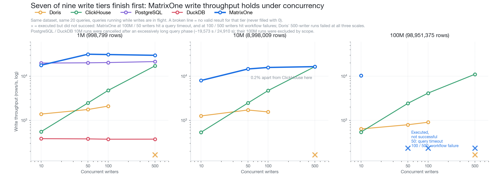
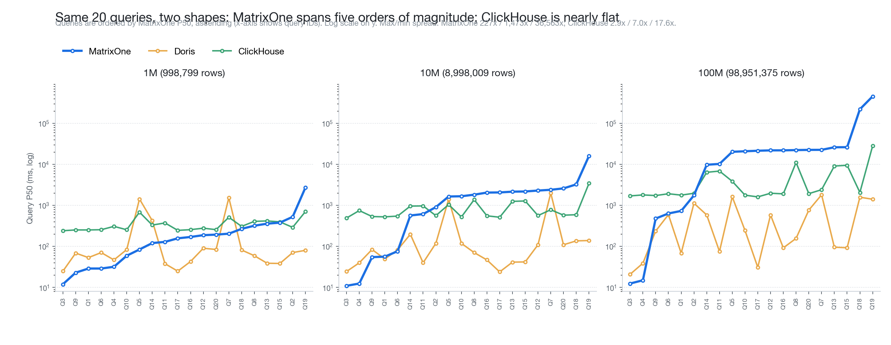
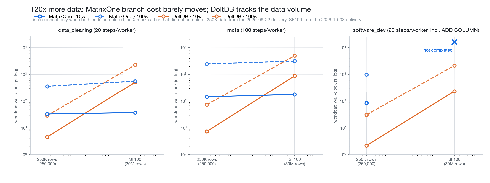

# Five Stages, One Data Foundation

> An Agent platform's data travels five stages: store it, process it, query it, remember it, run it. Each stage can be bought as a separate product — and the pieces will work together. The price does not appear on any quote: it appears in sync pipelines, cross-system consistency, and on-call rotation. This article measures all five, and writes down where each one stops working.

## One Agent data chain, five stages

An Agent platform's data moves through five stages: **store → process → query → remember → run.**

MatrixOrigin's products cover all five. The data foundation and Agent memory run directly on MatrixOne; natural-language query executes natively inside MatrixOne.

Each section below gives the scenario, the number, and the comparison. **None of the five stages is a clean sweep** — each one fails differently, and what decides whether a system works for you is never its best result, but where its boundary sits.

---

## 1. Data foundation: it takes the writes, and it answers the queries

### Writes: 31,473 rows/s, and throughput holds as concurrency rises

Every Agent step produces trace data. Write throughput decides how high your sampling rate can go — **and sampling rate is not a policy choice, it is a throughput constraint.**

One Agent log dataset, the same 20 queries, with queries running while writes are in flight:

| Scale | Writers | MatrixOne | Doris | ClickHouse | PostgreSQL | DuckDB |
| --- | ---: | ---: | ---: | ---: | ---: | ---: |
| 1M | 10 | 17,747 | 1,384 | 552 | **19,812** | 383 |
| 1M | 50 | **31,473** | 1,756 | 2,474 | 20,093 | 379 |
| 1M | 100 | **30,929** | 2,096 | 4,753 | 20,367 | 372 |
| 1M | 500 | **29,719** | failed | 17,091 | 21,408 | 373 |
| 10M | 10 | **7,987** | 1,255 | 536 | — | — |
| 10M | 50 | **14,559** | 1,710 | 2,466 | — | — |
| 10M | 100 | **15,762** | 1,548 | 4,713 | — | — |
| 10M | 500 | 16,453 | failed | **16,481** | — | — |
| 100M | 10 | **10,320** | 636 | 542 | out of scope | out of scope |

Rows per second. **MatrixOne finishes first in 7 of the 9 valid tiers** (10M/500 is 0.2% behind ClickHouse and is counted as a tie).

The more useful number is not the 7. It is this: **going from 50 writers to 500 writers — 10x the concurrency — throughput moves from 31,473 to 29,719, a 5.6% drop.**

In the same table: ClickHouse reaches 17,091 at 500 writers (its write path scales with concurrency); Doris' 500-writer runs failed outright; DuckDB sits at 370–380 throughout — throughput flat, while write latency climbs from 190 ms to 8,723 ms.

### Queries: one trace, 12 milliseconds

The single most frequent action in Agent observability is **opening one trace to see how it ran**.

| | 1M rows | 10M rows | 100M rows |
| --- | ---: | ---: | ---: |
| **MatrixOne** | **12.0 ms** | **11.0 ms** | **12.5 ms** |
| Doris | 25.0 ms | 24.5 ms | 21.0 ms |
| ClickHouse | 242.0 ms | 493.0 ms | **1,707.0 ms** |

**Data grows 120x; the number barely moves.** At 100M rows MatrixOne is 137x faster than ClickHouse — because ClickHouse scans for this query instead of seeking.

Mix all 20 queries together and the picture distorts: at 100M rows they span 12.5 milliseconds to 457 seconds. Split by shape, the dividing question is just: **does this query need to evaluate a non-columnar expression on every row?**

| Tier | Query shape | MatrixOne | Doris | ClickHouse |
| --- | --- | ---: | ---: | ---: |
| 1 | Single-trace replay / chain expansion | **12.5–15.0 ms** | 21–39 ms | 1,707–1,805 ms |
| 2 | Time-range and tenant filter + sort + LIMIT | 736 ms | **68.5 ms** | 1,784 ms |
| 3 | Full-table aggregate on native columns | 479–1,763 ms | **238–1,132 ms** | 1,743–1,981 ms |
| 4 | JSON path evaluation | 20,948–22,678 ms | **31–1,820 ms** | 1,616–2,421 ms |
| 5 | Text substring match | 9,816–26,338 ms | **76–1,629 ms** | 3,876–11,123 ms |
| 6 | Both combined | 221,202–457,039 ms | **1,417–1,588 ms** | 2,074–28,422 ms |

(P50 at 100M rows.) **Tiers 1–3 are the everyday work of Agent observability; the selection guidance for tiers 4–6 is in the table at the end.**

### Branching: 120x more data, 1.1–1.6x more time

N Agents explore in parallel, each opening its own branch, modifying data, then merging or rolling back. Data grows from 250K rows to SF100 (`order_line` = 30M rows, roughly 120x):

| Workflow / concurrency | MatrixOne change | DoltDB change |
| --- | ---: | ---: |
| data_cleaning / 10 | **1.13x** | 111.7x |
| data_cleaning / 100 | **1.55x** | 78.8x |
| mcts / 10 | **1.23x** | 119.9x |
| mcts / 100 | **1.28x** | 67.8x |

**Agent data only grows. An architecture whose branch cost scales linearly with data has a shelf life; one whose cost does not, doesn't.**

Across the four SF100 points where both systems completed, MatrixOne is 1.6–13.7x faster.

### Loading: slowest on the cold path, 112x faster on the hot one

At 100M rows, first import takes 12,303.7 s — **the slowest of the three**, and that timing includes a step the comparators do not have: a first `DUMP TABLE` and cache publish after the raw import (12,114.2 s import + 189.4 s publish).

But the same dataset has a second path: **110.3 s from cache, 112x faster.** The comparators ran raw imports in this round and **have no equivalent cache-restore path**.

Regression runs, bug reproduction, parallel branch exploration — all of them are "spin up the same trace environment again". **Budget time for the first load; after that it is nearly free — and that is what the slow cold path buys.**

---

## 2. Data processing: 84.5% on complex documents

Before documents reach an Agent they have to become structured data. On 50 complex semiconductor-industry documents (cross-page tables, merged cells, formulas, headers and footers):

**84.5% overall accuracy**, against Peer A 58.6% and Peer B 56.8%.

| Dimension | MOI | Peer A | Peer B |
| --- | ---: | ---: | ---: |
| Formulas | **91.9%** | 33.4% | 9.8% |
| Headers & footers | **84.7%** | 33.1% | 39.2% |
| Table structure (TEDS) | **73.1%** | 38.9% | 51.0% |

**The advantage concentrates in structural repair:** 58.5 points on formulas, 45.6 points on headers and footers. That is a pipeline-engineering gap, not a model-selection gap.

---

## 3. Retrieval and query: finding it is not the same as answering it

### Natural-language query: +20 points on colloquial phrasing

With a shared generation model, enabling the business semantic layer lifts automatic execution accuracy to 66.00%, against Peer A 51.33% and Peer B 32.67%.

**What the semantic layer actually fixes is colloquial phrasing** — strict accuracy on colloquial questions rises from 62.67% to 82.67%; the accuracy drop caused by colloquial phrasing is 8.00 points for MOI, versus 22.67 and 29.34 for the comparators.

### Knowledge retrieval: Recall@1 59.50%, highest of the three

On a mixed corpus of 297 documents and 275 QA pairs: Recall@1 59.50%, FastGPT 56.07%, Dify 54.34%; retrieval latency 981.9 ms, second fastest of the three.

**An Agent reads the top few results closely rather than stuffing all ten into the model — if the first one is wrong, a complete recall list further down cannot save it.**

---

## 4. Agent memory: governed, and correct

Memory is two separate things: **can you govern it**, and **can it answer correctly**.

### State management

| Capability | Cases passed |
| --- | ---: |
| Snapshot and rollback | 50 / 50 |
| Low-confidence governance | 50 / 50 |
| Branch / diff / merge | 48 / 50 |
| Deduplication | 36 / 50 |

### Long-term QA and diagnostics

LongMemEval-S, measured locally: 91.80%.

The more useful result is the diagnostic: **Top-20 complete-evidence recall is 94.04%; when evidence is complete, answer accuracy is 95.48%, and when it is incomplete, 28.57%.**

**Long-conversation errors are mostly "did not find it", not "read it wrong" — which makes the fix direction clear.**

---

## 5. Agent runtime: pass the gate first, then compare capability

The first four stages are all things you can re-run. This one has an element you cannot: **once an action leaves the system, it does not come back.**

### The gate: how many times the same business action was executed

24 real database-modification tasks, four runtimes, 96 run combinations:

| Runtime | Same business action executed twice |
| --- | ---: |
| **Astra** | **0** |
| Hermes | 0 |
| Pi | 2 |
| DSH | 3 |

**This is not a metric you can weight.** Actions that leave cannot be recalled, so "did too much" must not be offset by "used less".

One detail worth noting: two of DSH's three occurred on "precise rollback of a failed sub-batch" — every final-state check on that task was green, **yet the action ran twice**. Look only at end state and this defect is invisible.

### The two that passed the gate, compared

Across 11 comparisons between Astra and Hermes, Astra leads 9.

| | Astra | DSH | Pi | Hermes |
| --- | ---: | ---: | ---: | ---: |
| Toolathlon (108 tasks) | **80** | 79 | 77 | 72 |
| Terminal-Bench (89 tasks) | 48 | 49 | **52** | 45 |
| CPU median, commonly-passed tasks | **18.52 s** | 23.61 s | 74.03 s | 122.98 s |
| Peak memory median, commonly-passed tasks | **87.35 MiB** | 226.13 | 259.23 | 217.27 |

**First on the largest evaluation, third on terminal tasks; lowest on both CPU and memory, with peak memory about 40% of the other three.**

---

## Why these numbers are trustworthy

- **Versions pinned**: every number maps to a specific commit and image digest; engine version and workflow version are recorded separately.
- **Complete results**: failed, timed-out and unexecuted tiers are kept — never filled with 0, never replaced by another scale or concurrency level.
- **Protocols not mixed**: local measurements and published product results are shown side by side, with sources, and are not treated as same-condition rankings.
- **Reproducible**: the 20 Agent-log queries retain 48 valid runs and 960 per-query rows with raw samples.

---

## When this fits, and when it does not

| Your scenario | Guidance |
| --- | --- |
| Write-heavy Agent traces | **Fits**: 31,473 rows/s, 5.6% drop from 50 to 500 writers |
| Opening a single trace to debug | **Fits**: 12 ms, flat across data size |
| Spinning up the same trace repeatedly (regression, repro) | **Fits**: 110 s from cache, 112x faster |
| Multi-Agent parallel branching (data-mutation workflows) | **Fits**: cost decoupled from data volume |
| Complex document layout reconstruction | **Fits**: 84.5%, 25.9 points ahead |
| Business users asking questions in natural language | **Fits**: +20 points from the semantic layer |
| State management for long-term memory | **Fits**: snapshot/rollback 50/50, branch/merge 48/50 |
| An Agent runtime that respects boundaries | **Fits**: 24 tasks × 96 runs, zero out-of-scope actions |
| **JSON attribute drill-down / full-text search at 100M rows** | **Needs dedicated evaluation**: tiers 4–6 run 21 s to 457 s |
| **Branching workflows with frequent physical DDL** | **Not completed this round**: `software_dev` unfinished at all three tiers |
| **Open-ended field extraction** | **Not a strength**: 64.57% (no cross-product comparison this round) |
| **RAG answer generation** | **Behind by 23.71 points**: Token F1 61.95% vs 85.66% |
| **Business pass rate on short tasks** | **20/24 on 24 tasks** (Hermes 23, Pi 22, DSH 21) |

This table is, in our view, the most useful page of the evaluation. Every row traces back to raw data, and every row can be re-checked.

---

## Summary

**Five stages, one data foundation.**

- **Data foundation**: 31,473 rows/s with no concurrency collapse; 12 ms to open a trace; branch cost decoupled from data volume.
- **Data processing**: 84.5% on complex documents, with the edge in structural repair.
- **Retrieval and query**: +20 points on colloquial natural-language query; Recall@1 highest of the three.
- **Agent memory**: state management near-perfect; long-conversation limits traced to retrieval completeness.
- **Agent runtime**: zero out-of-scope actions, first on Toolathlon, lowest resource use.

**The value of this chain is not that every stage is the strongest. It is that they run on one data foundation — and that the boundary of every stage has been measured.**

---

*Method notes: Agent logs (agentlogsbench) at 998,799 / 8,998,009 / 98,951,375 actual rows, 20 queries × 10 timed executions each, MatrixOne `77dbf546`; branching at SF100 (`order_line` 30M rows), DoltDB `dolt-sql-server:2.2.3`; document parsing on 50 complex semiconductor-industry documents; NL query on Enron Eval 50 with a shared generation model `qwen3.7-plus-2026-05-26`; knowledge retrieval on 297 documents / 275 QA pairs; memory on LongMemEval-S (500 questions); runtime with Astra `969550b`, Hermes `f4df260f`, Pi `@mariozechner/pi-coding-agent@0.73.1`, DSH `0.1.0-rc.7`, all four routing MatrixOne operations through the same MCP gateway.*

*MatrixOne, MOI, Memoria and Astra are MatrixOrigin products. The evaluations in this article were run by the MatrixOrigin team. "Peer A / B" are anonymised comparators; the data-processing and retrieval sections refer to different products in each case, and their names are available in the corresponding technical reports.*
