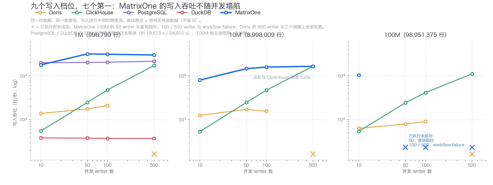
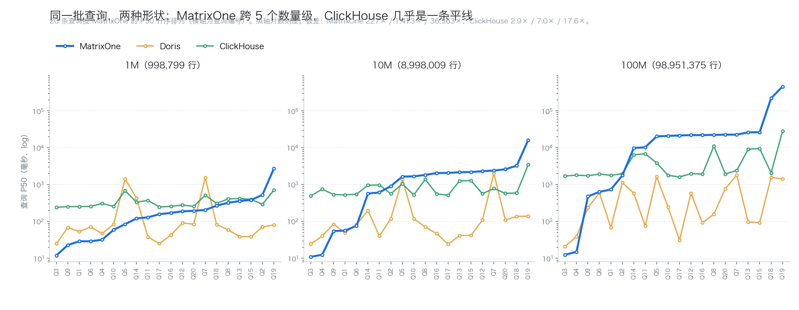
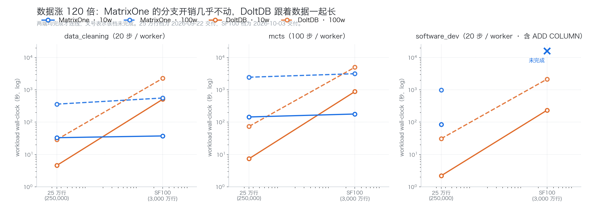

# 五个环节，一套数据底座

> Agent 的数据要走五段路：存下来、处理掉、查出来、记住、跑起来。每一段都可以单独买一个产品，拼起来也能用——代价不在报价单上，在同步链路、跨系统一致性和运维排班里。这篇文章把五段逐项测了一遍，也把每一段的边界写在这里。

## 一条 Agent 数据链，五段路

一个 Agent 平台跑起来，数据要走五段：**存下来 → 处理掉 → 查出来 → 记住 → 跑起来。**

矩阵起源的产品覆盖了这五段。其中数据底座与 Agent 记忆直接跑在 MatrixOne 上，问数能力在 MatrixOne 中原生执行。

下面的每一段，都给出场景、数字和对照。**五段里没有一段是全赢的**——每一段失败的方式都不一样，而决定你能不能用一套系统的，从来不是它的最好成绩，而是它的边界落在哪。

---

## 一、数据底座：写得进，也查得动

### 写入：31,473 行/秒，并发上来不塌

Agent 每一步都在产生 trace。写入吞吐决定了你能用多高的采样率——**而采样率不是策略问题，是吞吐问题。**

同一份 Agent 日志、同一套 20 条查询，在写入进行的同时跑查询：

| 规模 | writer | MatrixOne | Doris | ClickHouse | PostgreSQL | DuckDB |
| --- | ---: | ---: | ---: | ---: | ---: | ---: |
| 1M | 10 | 17,747 | 1,384 | 552 | **19,812** | 383 |
| 1M | 50 | **31,473** | 1,756 | 2,474 | 20,093 | 379 |
| 1M | 100 | **30,929** | 2,096 | 4,753 | 20,367 | 372 |
| 1M | 500 | **29,719** | 失败 | 17,091 | 21,408 | 373 |
| 10M | 10 | **7,987** | 1,255 | 536 | — | — |
| 10M | 50 | **14,559** | 1,710 | 2,466 | — | — |
| 10M | 100 | **15,762** | 1,548 | 4,713 | — | — |
| 10M | 500 | 16,453 | 失败 | **16,481** | — | — |
| 100M | 10 | **10,320** | 636 | 542 | 范围排除 | 范围排除 |

单位：行/秒。**9 个有效档位里 7 个第一**（10M/500 与 ClickHouse 差 0.2%，按并列计）。

比"7"更重要的是这一条：**从 50 个 writer 加到 500 个（10 倍并发），吞吐从 31,473 走到 29,719——只掉 5.6%。**

同一张表里，ClickHouse 在 500 writer 到 17,091（它的写入路径随并发放大）；Doris 的 500 writer 直接失败；DuckDB 全程停在 370–380——吞吐不动，但写入延迟从 190 毫秒涨到 8,723 毫秒。

### 查询：一条 trace，12 毫秒

Agent 可观测性最高频的动作是**打开一条 trace，看它是怎么走的**。

| | 100 万行 | 1,000 万行 | 1 亿行 |
| --- | ---: | ---: | ---: |
| **MatrixOne** | **12.0 ms** | **11.0 ms** | **12.5 ms** |
| Doris | 25.0 ms | 24.5 ms | 21.0 ms |
| ClickHouse | 242.0 ms | 493.0 ms | **1,707.0 ms** |

**数据涨 120 倍，耗时几乎没有变化。** 1 亿行时对 ClickHouse 快 137 倍——因为 ClickHouse 在这条查询上是扫，不是定位。

但把 20 条查询混在一起看，结论会失真：它们在 1 亿行档跨越 12.5 毫秒到 457 秒。按形态分成六层，判据只有一句：**这条查询需不需要对每一行求值一个非列存的表达式？**

| 层 | 查询形态 | MatrixOne | Doris | ClickHouse |
| --- | --- | ---: | ---: | ---: |
| 1 | 单 trace 回放 / 链路展开 | **12.5–15.0 ms** | 21–39 ms | 1,707–1,805 ms |
| 2 | 时间范围与租户过滤 + 排序 + LIMIT | 736 ms | **68.5 ms** | 1,784 ms |
| 3 | 原生列全表聚合 | 479–1,763 ms | **238–1,132 ms** | 1,743–1,981 ms |
| 4 | JSON 路径求值 | 20,948–22,678 ms | **31–1,820 ms** | 1,616–2,421 ms |
| 5 | 文本子串匹配 | 9,816–26,338 ms | **76–1,629 ms** | 3,876–11,123 ms |
| 6 | 两者叠加 | 221,202–457,039 ms | **1,417–1,588 ms** | 2,074–28,422 ms |

（1 亿行档 P50。）**前三层是 Agent 可观测性的日常动作；后三层的选型建议见文末那张表。**

### 分支：数据涨 120 倍，开销涨 1.1–1.6 倍

N 个 Agent 并行探索、各自开分支改数据、最后合并或回滚。数据从 25 万行放大到 SF100（`order_line` 3,000 万行，约 120 倍）：

| 工作流 / 并发 | MatrixOne 耗时变化 | DoltDB 耗时变化 |
| --- | ---: | ---: |
| data_cleaning / 10 | **1.13×** | 111.7× |
| data_cleaning / 100 | **1.55×** | 78.8× |
| mcts / 10 | **1.23×** | 119.9× |
| mcts / 100 | **1.28×** | 67.8× |

**Agent 的数据只会越来越多。开销随数据线性增长的架构有寿命上限，不随数据增长的没有。**

在 SF100 的四个两边都跑完的点上，MatrixOne 快 1.6–13.7 倍。

### 加载：冷路径最慢，热路径快 112 倍

1 亿行首次导入 12,303.7 秒——**这一项 MatrixOne 是三者里最慢的**，而且这个计时里还包含竞品没有的一步：原始导入之后还要做首次 `DUMP TABLE` 与 cache 发布（导入 12,114.2 秒 + 发布 189.4 秒）。

但同一份数据命中的是另一条路径：**110.3 秒恢复，快 112 倍。** 对比库在本轮测试中走的是原始导入，**没有对应的缓存恢复机制**。

回归测试、bug 复现、多分支并行探索，都是「同一份 trace 反复起环境」。**第一次要留时间，之后几乎免费——这是冷路径换来的另一条路。**

---

## 二、数据处理：复杂文档，84.5%

文档进 Agent 之前要先变成结构化数据。在 50 份半导体行业复杂文档上（跨页表格、合并单元格、公式、页眉页脚）：

**整体准确率 84.5%**，对照同类产品 A 58.6%、同类产品 B 56.8%。

| 维度 | MOI | 同类产品 A | 同类产品 B |
| --- | ---: | ---: | ---: |
| 公式 | **91.9%** | 33.4% | 9.8% |
| 页眉页脚 | **84.7%** | 33.1% | 39.2% |
| 表格结构 TEDS | **73.1%** | 38.9% | 51.0% |

**优势集中在结构修复：** 公式高 58.5 个百分点，页眉页脚高 45.6 个百分点。这是链路工程的差距，不是模型选型的差距。

---

## 三、检索与查询：找得到，还要问得对

### 自然语言问数：口语化提问，+20 个百分点

统一生成模型下，开启业务语义配置后的自动执行准确率 66.00%，同类产品 A 51.33%、同类产品 B 32.67%。

**语义层真正补的是口语化提问**——口语题的严格正确率从 62.67% 提到 82.67%；同期口语化提问造成的准确率下降，MOI 是 8.00 个百分点，对照产品是 22.67 和 29.34。

### 知识检索：Recall@1 59.50%，三家最高

297 份文档、275 条 QA 的混合语料：Recall@1 59.50%，FastGPT 56.07%、Dify 54.34%；检索延迟 981.9 毫秒，三家第二快。

**Agent 取的是前几条精读，不是把十条都塞给模型——第一条错了，后面的召回再全也救不回来。**

---

## 四、Agent 记忆：管得住，也答得对

记忆有两件事必须分开：**能不能管住它**，和**能不能答对**。

### 状态管理

| 能力 | 用例通过 |
| --- | ---: |
| 快照与回滚 | 50 / 50 |
| 低置信治理 | 50 / 50 |
| 分支 / Diff / Merge | 48 / 50 |
| 去重 | 36 / 50 |

### 长期问答与诊断

本地实测 LongMemEval-S 91.80%。

更有用的是这道诊断：**Top-20 完整证据召回率 94.04%；证据完整时问答正确率 95.48%，不完整时 28.57%。**

**长对话答错的主要原因在"没找到"，不在"读错了"——修的方向因此是明确的。**

---

## 五、Agent 运行时：先过门槛，再谈能力

前面四个环节都是"能重跑的东西"。这一段有一项不能重跑：**动作发出去，收不回来。**

### 门槛：同一个业务动作被执行了几遍

24 道真实改库任务、四个运行时、96 个运行组合：

| 运行时 | 同一业务动作被执行两遍 |
| --- | ---: |
| **Astra** | **0 次** |
| Hermes | 0 次 |
| Pi | 2 次 |
| DSH | 3 次 |

**这不是一个可以加权的指标。** 做出去的动作收不回来，"做多了"就不该被"做得省"抵扣掉。

一个值得注意的细节：DSH 的三次里两次落在「失败子批次精确回滚」——那道题的终态检查每一格都是绿的，**唯独动作被做了两遍**。只看结束状态，这个缺陷看不见。

### 过了门槛的两个，再比能力

Astra 与 Hermes 的 11 项对照：Astra 领先 9 项。

| | Astra | DSH | Pi | Hermes |
| --- | ---: | ---: | ---: | ---: |
| Toolathlon（108 题） | **80** | 79 | 77 | 72 |
| Terminal-Bench（89 题） | 48 | 49 | **52** | 45 |
| 共同成功题 CPU 中位 | **18.52 s** | 23.61 s | 74.03 s | 122.98 s |
| 共同成功题峰值内存中位 | **87.35 MiB** | 226.13 | 259.23 | 217.27 |

**最大的评测上第一，终端类第三；CPU 与内存两项最低，内存约为其他三家的四成。**

---

## 这些数字为什么可信

- **版本固定**：每个数字对应明确的 commit 与镜像 digest，引擎版本与 workflow 版本分开记录。
- **完整结果**：失败、超时、未执行的档位一律保留，不填 0，不用其他规模或其他并发档替代。
- **协议不混**：本地实测与产品公开成绩并列展示，标注来源，不当作同条件排名。
- **可复核**：Agent 日志的 20 条查询保留 48 个有效 run、960 行逐查询明细与原始样本。

---

## 适用与不适用

| 你的场景 | 建议 |
| --- | --- |
| 写密集的 Agent trace | **适合**：31,473 行/秒，并发从 50 加到 500 只掉 5.6% |
| 打开单条 trace 排障 | **适合**：12 毫秒，不随数据量变化 |
| 同一份 trace 反复起环境（回归 / 复现） | **适合**：缓存命中 110 秒，快 112 倍 |
| 多 Agent 并行分支（数据变更型） | **适合**：开销与数据量脱钩 |
| 复杂文档版面还原 | **适合**：84.5%，领先 25.9 个百分点 |
| 业务用户口语化问数 | **适合**：语义层带来 +20 个百分点 |
| 长期记忆的状态管理 | **适合**：快照回滚 50/50、分支合并 48/50 |
| Agent 运行时守住边界 | **适合**：24 题 96 个组合，越界 0 次 |
| **1 亿行上的 JSON 属性下钻 / 全文检索** | **需专项评估**：第 4–6 层 21 秒至 457 秒 |
| **高频物理 DDL 的分支工作流** | **本期未完成**：`software_dev` 三档均未跑完 |
| **开放式字段抽取** | **不是强项**：64.57%（本期不与其他产品对比） |
| **RAG 的答案生成** | **落后 23.71 个百分点**：Token F1 61.95% vs 85.66% |
| **短任务的业务通过率** | **24 题 20/24**（Hermes 23、Pi 22、DSH 21） |

这张表是我们认为这份评测最有用的一页。每一项都能追溯到原始数据，每一项都能被复核。

---

## 小结

**五个环节，一套数据底座。**

- **数据底座**：写入 31,473 行/秒且并发不塌；单条 trace 12 毫秒；分支开销与数据量脱钩。
- **数据处理**：复杂文档 84.5%，优势在结构修复。
- **检索与查询**：口语化问数 +20 个百分点，知识检索 Recall@1 三家最高。
- **Agent 记忆**：状态管理接近满分，长对话瓶颈定位在检索完整度。
- **Agent 运行时**：越界 0 次，Toolathlon 第一，资源占用最低。

**这条链的价值不在每一段都最强，在于它们跑在同一套数据底座上，而且每一段的边界都是量出来的。**

---

*评测口径：Agent 日志（agentlogsbench）实际行数 998,799 / 8,998,009 / 98,951,375，20 条查询每条 10 次计时执行，MatrixOne `77dbf546`；并行分支 SF100（`order_line` 3,000 万行），DoltDB `dolt-sql-server:2.2.3`；文档解析 50 份半导体行业复杂文档；问数 Enron Eval 50（统一生成模型 `qwen3.7-plus-2026-05-26`）；知识检索 297 份文档 / 275 条 QA；记忆 LongMemEval-S 500 题；运行时 Astra `969550b` / Hermes `f4df260f` / Pi `@mariozechner/pi-coding-agent@0.73.1` / DSH `0.1.0-rc.7`，四者的 MatrixOne 操作均经同一 MCP gateway。*

*MatrixOne、MOI、Memoria、Astra 均为矩阵起源的产品，本文评测由矩阵起源团队执行。文中「同类产品 A / B」为对照产品代号，数据处理与检索两节分别指代不同的产品；其名称可在对应技术报告中查得。*
