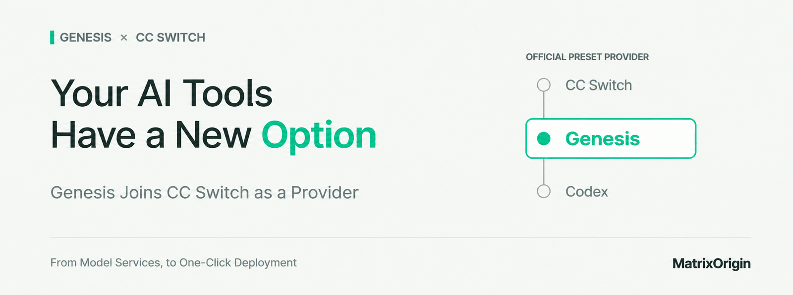
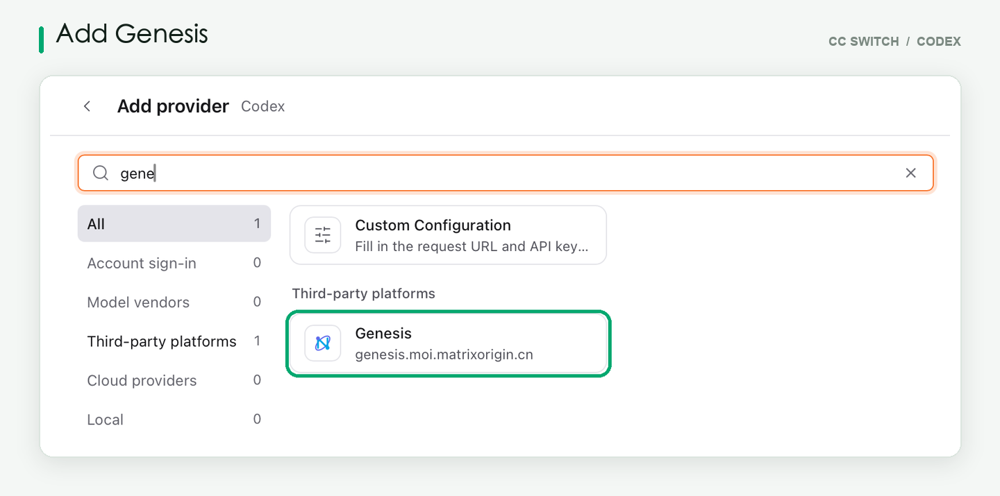
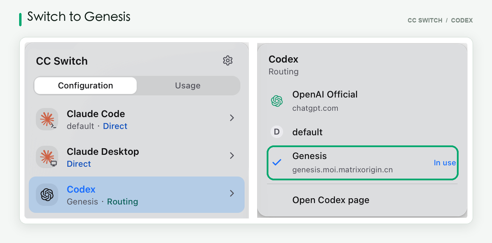

**Genesis Joins CC Switch's Official Preset Providers**

Genesis has been added to CC Switch's official preset providers, with the update rolling out in an upcoming release. Developers will be able to choose the Genesis model service in the AI coding tools they already know, making it easier to bring model capabilities into everyday development.

*You can find **Genesis** in the **Codex** provider list in **CC Switch**.*

From writing code to handling tasks, this integration gives developers one more model service to choose from — and brings Genesis one step closer to daily work. The model service is no longer just an API endpoint; it now fits into the workflows of everyday development and task handling.

*Select **Genesis** in **CC Switch** to switch **Codex** to the **Genesis** model service.*

## More Than Model Access: Let AI Take Part in Your Work

Once the model is connected, how do you get AI to make good use of your own materials, understand your business requirements, and help get tasks done?

**MOI, the all-in-one agent platform, brings together model services, enterprise knowledge, skills, tools, and the runtime environment.** You can describe what you need in natural language, create your own agent, then connect it to the knowledge and tools it requires — reducing the burden of stitching multiple systems together yourself.

It can be a knowledge assistant that reads product documentation, answers questions, and provides references. It can also be a data assistant that queries business data in tables through natural language. For more specific work, it can apply business rules to help review expense records and flag items that need manual review, or organize R&D feedback into a GitHub Issue and submit it after your confirmation.

From Genesis providing model services to MOI supporting all-in-one agents, MatrixOrigin aims to connect "finding information, understanding it, and taking action," so that AI does more than answer questions — it helps complete work. Teams can combine models, knowledge, tools, and the execution environment to build agents suited to their own business, turning one-off conversations into repeatable workflows.

## Let AI Take Part in Your Next Task

If you're comfortable with your current coding tools, start with the Genesis model service. If you want to build your own agent, head to MOI and start with a document, a question, or a repetitive task.

**You don't have to change all your work habits at once. Start by letting AI do one thing well for you.**

## Four Perks Continue, Invite Limit Raised to 10

**1. Register and Activate**

Get 1,000 Credits. Register and activate your account for the first time to receive 1,000 Credits, equivalent to RMB 100.

**2. Submit Valid Feedback**

Get 200 Credits. Submit an issue through the "Feedback" entry on the right side of the page; once it is confirmed as valid, you will receive 200 Credits.

**3. Complete Platform Tasks**

Earn up to 1,500 Credits in total. Complete the designated platform tasks to accumulate up to 1,500 Credits.

**4. Invite Friends**

You and your friend each get 500 Credits — invite up to 10 people. When a friend registers and activates through your invite link, both you and your friend receive 500 Credits. You can now invite up to 10 people, earning up to 5,000 Credits as the inviter.

Share the event with friends who are building AI applications, exploring agents, or need model API access — try it together and claim the rewards together.

All billable items on the platform are priced in Credits. See "Product Pricing" in the Billing Center for details.

Tried it out? Tell us about your experience

Which tasks went smoothly? Where did you need repeated revisions? Did you run into failed calls, outputs that didn't meet requirements, or issues during integration?

You're welcome to share your actual experience through the "Feedback" entry on the right side of the page.

When submitting, please describe the task you wanted to complete, the steps you took, and the gap between the expected and actual results. Screenshots are welcome too. This information helps us locate issues faster — and feedback confirmed as valid earns a 200-Credit reward.

——— ✦ ———

Get your tasks ready, and invite your friends to try it too.

[Visit MOI to explore Genesis and the all-in-one agent platform](https://uc.moi.matrixorigin.cn/login?lang=en-US)
