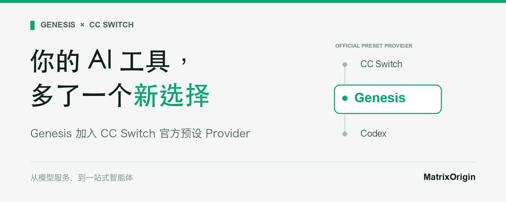
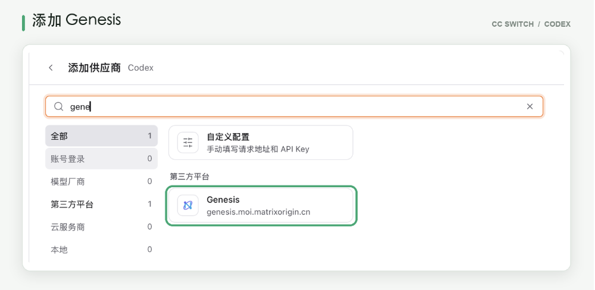
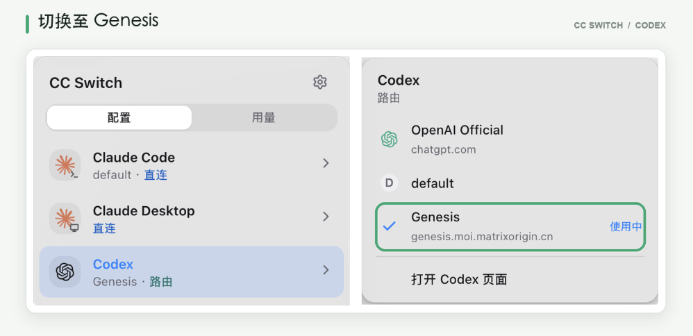

**Genesis 加入 CC Switch 官方预设 Provider**

Genesis 已被纳入 CC Switch 官方预设 Provider，相关更新将随版本发布。开发者将能在熟悉的 AI 编码工具中选择 Genesis 模型服务，让模型能力更方便地融入日常开发。

*在** CC Switch **的** Codex **供应商列表中，可以找到** Genesis**。*

从编写代码到处理任务，这次接入让开发者多了一种模型服务选择，也让 Genesis 离日常工作更近了一步。模型服务不再只是一个 API 入口，而是进入了日常开发和任务处理的工作流。

*在** CC Switch **中选择** Genesis**，将** Codex **切换至** Genesis **模型服务。*

## 不止接入模型，更让 AI 参与工作

模型接入之后，如何让 AI 用好自己的资料、理解业务要求，并协助完成任务？

**MOI 一站式智能体平台，将模型服务、企业知识、技能、工具与运行环境整合在一起。** 用户可以用自然语言描述需求，创建自己的智能体，再为它接入所需的知识和工具，减少自行拼接多个系统的负担。

它可以是一个知识助手，查阅产品文档、回答问题，并提供参考来源；也可以是一个数据助手，通过自然语言查询表格中的业务数据。面对更具体的工作，还可以结合业务规则辅助检查报销记录、标出需要人工复核的问题，或把研发反馈整理成 GitHub Issue，在确认后提交。

从 Genesis 提供模型服务，到 MOI 支持一站式智能体，MatrixOrigin 希望把“找资料、理解信息、采取行动”连接起来，让 AI 不只回答问题，也能协助完成工作。团队可以结合模型、知识、工具和执行环境，创建适合自身业务的智能体，把一次次对话延伸成可重复的工作流程。

## 让 AI 参与你的下一项工作

习惯现有编码工具，可以从 Genesis 模型服务开始；希望构建自己的智能体，可以到 MOI，从一份文档、一个问题或一项重复工作开始。

**不必一次改变所有工作习惯，先让 AI 帮你做好一件事。**

## 四项福利继续，邀请名额增至 10 人

**1注册激活**

即得 1,000 Credit。首次注册并激活账户，即可获得 1,000 Credit，价值相当于人民币 100 元。

**2提交有效反馈**

获得 200 Credit。通过页面右侧「反馈」入口提交问题，经判定有效后，获得 200 Credit。

**3完成平台任务**

累计可得 1,500 Credit。完成平台指定任务，累计可获得 1,500 Credit。

**4邀请好友**

双方各得 500 Credit，最多邀请 10 人。好友通过你的邀请链接注册并激活后，你与好友各得 500 Credit。现在最多可邀请 10 人，邀请方累计可获得 5,000 Credit。

把活动分享给正在开发 AI 应用、探索智能体或有模型调用需求的朋友，一起体验，也一起领取奖励。

平台各计费项以 Credit 计价，具体价格可在计费中心「产品定价」查看。

体验之后，把你的发现告诉我们

哪些任务完成得顺畅？哪些地方需要反复修改？有没有遇到调用失败、输出不符合要求，或接入过程中的问题？

欢迎通过页面右侧的 「反馈」 入口，留下你的实际使用经历。

提交时，请尽量说明想完成的任务、操作步骤，以及预期结果与实际结果的差异；如有截图，也可以一并附上。这些信息能帮助我们更快定位问题，经判定有效的反馈还可获得 200 Credit 奖励。

——— ✦ ———

准备好你的任务，也邀请朋友一起来体验。

[访问 MOI，了解 Genesis 与一站式智能体](https://uc.moi.matrixorigin.cn/login?)
