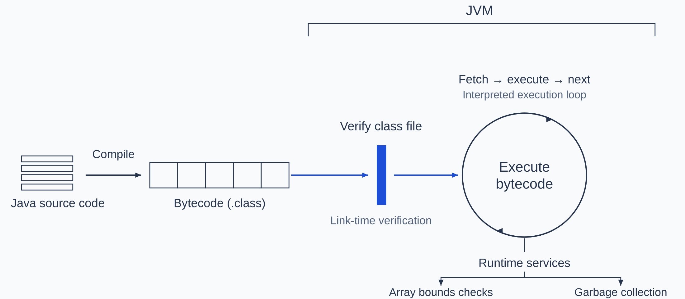
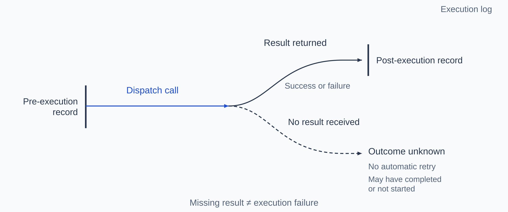
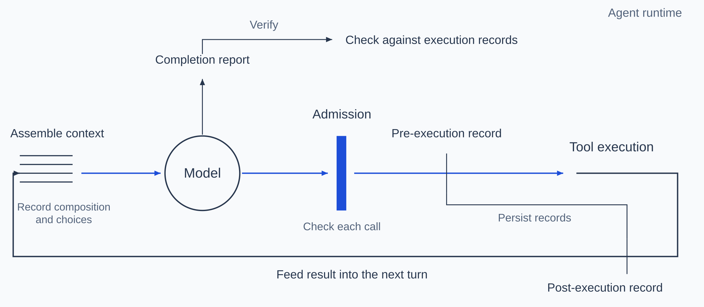
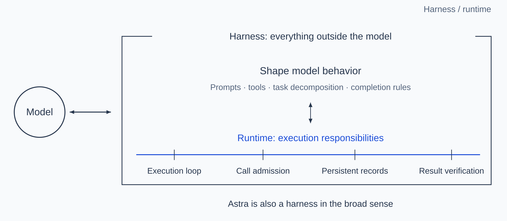
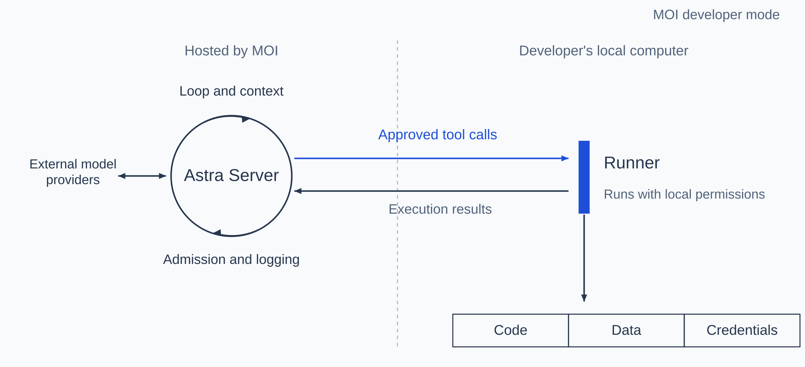
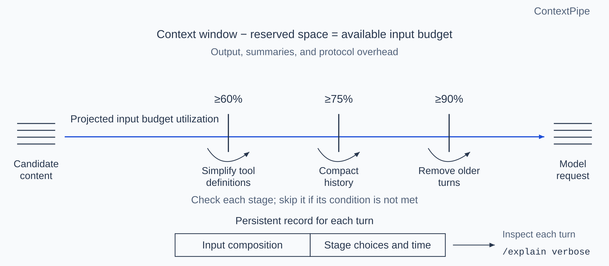

MatrixOne Intelligence (MOI), MatrixOrigin's AI data platform, now offers developer mode. From a local terminal, developers can ask an agent to query data, import and export files, run existing workflows, create knowledge bases, and add content to them on MOI.

These tasks are driven by [Astra](https://github.com/matrixorigin/Astra), MatrixOrigin's open-source agent runtime. The agent uses moi-cli, MOI's command-line tool, to access the platform. Facts, preferences, and decisions accumulated during tasks can be retained for later sessions through Memoria, the long-term memory system behind Astra.

Astra and Memoria are integrated into the MOI enterprise platform. Developers install the local client and companion tools, then sign in with their MOI account. They do not need to deploy services themselves, supply model API keys, or create separate personal access tokens.

On macOS or Linux, run the following command in a terminal to install the Astra client, its companion executables, moi-cli, and skills:

```bash
$ curl -fsSL https://get.matrixorigin.cn/astra | sh
```

After installation, run `astra login` to sign in to your MOI account, then run `astra` to start a conversation.

A model proposes an agent's tool calls, which can execute with the developer's identity and permissions once approved by the runtime. When a task encounters a problem, developers need to know what it actually executed and where the problem occurred. If execution is slow or token usage is excessive, they need to inspect the time spent at each stage and the composition of each turn's input. When the agent claims an issue is fixed, they also need to check that its conclusion matches the execution results. These judgments require records of the run.

Astra places admission, logging, and verification in the layer that drives the agent. Before each model-generated tool call runs, Astra decides whether to allow it and records the call before dispatch; when a result returns, it records that result too. Every model request passes through the same context assembly pipeline, which records the input's composition and the choices made when assembling it. Astra also checks execution evidence supporting the agent's completion report. This layer both runs the agent and gives developers a basis for inspecting its behavior; we therefore call it an agent runtime. The following sections explain its responsibilities and implementation, and how developer mode helps us debug agents the way we debug software.

## What is a runtime?

Runtime is a concept from programming languages. On platforms such as Java and .NET, it refers to software that executes a program and provides services while it runs. In Java, the Java Virtual Machine (JVM) is the execution engine at the core of the runtime environment, alongside supporting libraries and other components. Java programs are compiled into bytecode, stored in class files, and executed by the JVM.

[The Java Virtual Machine Specification](https://docs.oracle.com/javase/specs/jvms/se25/html/jvms-2.html#jvms-2.11) illustrates interpreted bytecode execution as a loop: fetch the next instruction, execute it, and fetch the next one.

The JVM also provides services beyond execution. Before execution, it verifies that class files meet the specification's constraints. Class files produced by a conforming Java compiler should satisfy those constraints, but [the specification notes](https://docs.oracle.com/javase/specs/jvms/se25/html/jvms-4.html#jvms-4.10) that the JVM cannot guarantee that a file it loads came from such a compiler. Files may arrive over a network or be crafted by an attacker to exploit a virtual machine vulnerability. During execution, the [iaload instruction](https://docs.oracle.com/javase/specs/jvms/se25/html/jvms-6.html#jvms-6.5.iaload) loads an int from an array and throws an ArrayIndexOutOfBoundsException if the index is out of bounds, enforcing array bounds at runtime. The garbage collector can reclaim objects that are no longer reachable by the program.

The JVM manages bytecode execution, either by interpreting instructions or by compiling them into machine code. This execution role allows it to provide services such as runtime checks and memory management. Together with its supporting components, it forms Java's runtime environment.



Figure 1 | JVM execution and runtime services (interpreted execution)

## How an agent runtime supports debugging

An agent also runs in a loop. In its article introducing the hosted service [Managed Agents](https://www.anthropic.com/engineering/managed-agents), Anthropic describes a harness as a loop that calls the model and routes its tool calls to the appropriate infrastructure for execution. The harness corresponds to the execution part of the JVM: every model-generated tool call passes through it. The JVM provides services beyond execution; what an agent needs beyond a harness depends on how it differs from a Java program.

The JVM verifies class files because it cannot assume they came from a compiler that meets the specification. Model-generated tool calls also need checking: a model may misread an error message, supply incorrect arguments, or be subject to prompt injection. JVM verification examines already generated class files as part of linking. An agent's tool calls, by contrast, are generated incrementally from the evolving context, including earlier tool results. A model response can contain one call or several. Each call therefore needs a check between generation and execution to decide whether to allow it. This step is called admission.

Developers can configure logging in advance, but an agent's exact tool calls are generated during the run. Those calls may modify files, commit code, and invoke external APIs, leaving effects outside the process. Repeating the same task may produce different calls. The layer through which every call passes must therefore persist a record before dispatch and record the result when it returns. If dispatch may have occurred but no result was received, the outcome is unknown. For example, if the network disconnects after a deployment command is sent but before the result returns, deployment may have completed or may not have started. Automatically retrying could deploy twice. Astra does not automatically repeat such an ambiguous operation; its outcome must be reconciled before another execution is considered.



Figure 2 | Records before and after execution; a missing result does not mean failure

A garbage collector decides what memory to reclaim based on whether objects remain reachable. An agent's context has no general equivalent: any part of the supplied context may influence the model's next response. As input approaches the context window limit, reachability alone cannot establish which content can be removed or summarized without changing model behavior. Content order also affects cost. Prefix-based prompt caching reuses an unchanged input prefix; a change near its beginning can reduce how much of the later content can be reused. Context assembly choices therefore need to be inspectable afterward, with records showing what was included, summarized, or removed.

For ordinary software, test results provide evidence about whether execution produced the expected outcome. An agent may end a task by reporting that tests passed, but that statement is also generated by the model. It may misremember which run succeeded or fail to rerun tests after its last edit. The runtime holds the records of every call. When an agent's report conflicts with those records, the records take precedence.

The layer that drives the loop and takes on these responsibilities is called an agent runtime. It remains active while the agent runs: it initiates every model call, and every model-generated tool call passes through it. Developers investigating a problem can inspect a call's execution state or the choices made in assembling a turn's context. When an agent's report conflicts with the execution records, the runtime uses the records as the basis for verification.



Figure 3 | The agent runtime loop, admission, logging, and verification

Bytecode verification and runtime checks help the JVM enforce rules such as type safety and array bounds; they do not prove that a program's logic is correct. An agent runtime similarly provides execution checks and records, while task quality also depends on the model and on how prompts and tools are arranged.

## Runtime vs. harness

The term harness has both a narrow and a broad meaning. In the narrow sense, it is the loop described above. In the broad sense, it includes everything outside the model. [LangChain](https://www.langchain.com/blog/the-anatomy-of-an-agent-harness) describes an agent as a model plus a harness; [the Claude Code documentation](https://code.claude.com/docs/en/glossary) similarly calls Claude Code the harness and Claude the model within it. In this broad sense, Astra is also a harness.

The broader use of harness includes how prompts are written, which tools are offered, how tasks are divided, and when to stop. These choices shape model behavior. Anthropic describes an example involving Claude Sonnet 4.5: when it noticed that its context window was almost full, it would end tasks early. Anthropic added context resets to the harness. After switching to Claude Opus 4.5, that behavior disappeared, and the resets became unnecessary overhead.

Admission and logging concern execution. Whatever the model's behavior, tool calls must pass admission before execution, dispatch and returned results must be recorded, and the composition of each input must be inspectable. Java has a similar division of responsibilities: a framework such as Spring helps organize a program, while the JVM executes bytecode and provides runtime services. Astra emphasizes responsibilities that span agent execution, so developers can inspect execution records as they adjust models, prompts, or tools.

Separating the harness from the underlying runtime already has precedents. LangChain's runtime handles durable execution, state persistence, and human intervention. Google's preview Agent Executor can host different harnesses. Amazon's AgentCore harness runs in microVMs provided by AgentCore Runtime.

In this division of responsibilities, the harness handles context assembly. Managed Agents keeps an append-only session log outside the harness. If a harness crashes, a new one reads the log and continues the run. Context management remains the harness's responsibility because the context engineering needs of future models cannot be predicted. In Astra, every assembly goes through the same pipeline, and the runtime records what was included and what was removed.



Figure 4 | Behavior coordination and runtime execution responsibilities within a harness

## How Astra supports debugging

Astra separates runtime control from tool execution, assigning them to the Server and Runner respectively. The Server calls the model, drives the loop, assembles context, and handles admission and logging. Model API keys are kept only on the Server. The Runner executes approved tool calls where the code, data, and credentials reside. In MOI developer mode, MOI hosts the Server, while the Runner and moi-cli run on the developer's local computer. The agent accesses MOI through the local moi-cli. Admission and logging are centralized on the Server, so records already written are unaffected if the execution machine restarts or loses its network connection.



Figure 5 | Server and Runner deployment in MOI developer mode

Teams can also deploy the Server themselves. Runners can be deployed inside private networks, with astra-edge executing tools. Some tools run on the Server itself. Astra includes no model; it can connect to OpenAI, Anthropic, DeepSeek, and model services compatible with the OpenAI API.

Whenever the model generates a tool call, the Server checks whether the tool is available in the current turn, which machine the session is bound to, and whether the arguments are valid. When the Server requests approval, it first writes the pending request to the database and then waits. Users can approve it from another device. Calls executed on the developer's local computer also pass through permission checks in a fixed order: the blocklist, dangerous commands, destructive repository operations, and access to sensitive files are checked first. Only then is the user's selected permission mode applied.

The Server records every tool call before dispatch and records the result when it returns. Calls executed by the Server itself or by astra-edge are also tracked in an execution ledger, with states Prepared, Dispatched, Succeeded, Failed, Rejected, and OutcomeUnknown. Results are written to the ledger before being passed to the model. Invocation identifiers support duplicate-dispatch prevention: the same recorded invocation is not dispatched again. A dispatched call whose outcome cannot be confirmed is marked OutcomeUnknown and is not automatically replayed. Restarting the Server does not by itself justify repeating an operation with an unknown outcome. When a database is configured, the Server stores these records in MatrixOne, MatrixOrigin's database. Developers investigating interruptions can distinguish confirmed failures from unknown outcomes and decide what to do next.

Execution records show what tools did. Inspecting the model's input also requires seeing how context was assembled. Astra's context assembly borrows from databases, based on the design in our [ContextPipe](https://arxiv.org/abs/2609.00749) paper (ADS/DATAI workshop, VLDB 2026). A database query optimizer generates execution plans under hard resource constraints; EXPLAIN ANALYZE shows both the plan and what actually happened during execution. The paper identifies corresponding elements in query optimization and context assembly:

| Element | Database query optimizer | Context assembly |
| --- | --- | --- |
| Intent | A query | The user's message |
| Catalog | Tables, indexes, and statistics | Sources, lifecycles, and costs of session content |
| Hard resource constraints | Memory and I/O | The model's context window |
| Tiered caching | Buffer pool | Prompt cache |

Astra implements assembly as a single pipeline. Model calls for main tasks, subtasks, skills, history compaction, and subagents all pass through it.

The pipeline subtracts space reserved for output, summaries, and protocol overhead from the context window, leaving the available input budget. It applies different transformations based on projected budget utilization: at 60%, it simplifies tool definitions; at 75%, it compacts history; at 90%, it removes older conversation turns. The value of content to a model cannot be estimated as precisely as a query cost, so the optimization uses heuristics. Each transformation has an activation condition and is skipped when that condition is not met.

The components of each model request and their sizes are recorded in the database. Each turn's record also states how many conversation turns were retained, compacted, or removed. During a conversation, enter `/explain verbose` to inspect the composition of each turn's context and the time spent at each stage, much as EXPLAIN ANALYZE shows a database query's plan and actual execution time.

For example, in a conversation querying an MOI workspace, the fourth turn's record shows 13,705 input tokens as reported by the model provider, including 8,192 read from cache. Astra separately estimated approximately 4,860 tokens for the system prompt, 1,816 for 17 tool definitions, and 221 for the three earlier conversation turns. Utilization was well below 60%, so the full history was retained without compaction. In a turn that does involve compaction, the record also shows which stages ran, how many tokens each stage freed, and the history size before and after compaction. Given identical content, statistics, and configuration, the pipeline produces byte-for-byte identical assembled context. When cache reuse drops, the records help developers investigate changes to the system prompt or tool definitions, a change of model or provider, or cache expiration.



Figure 6 | ContextPipe assembles requests within a budget and records each choice

An agent's report that a failure has been resolved is not sufficient evidence on its own. Astra checks the available execution evidence, keeping confirmed success or failure distinct from rejection, cancellation, and unknown outcomes. Follow-up evidence must relate to the operation being verified: an unrelated successful call cannot settle an earlier failed or interrupted operation. If the required evidence is missing or inconsistent, the result remains unverified. These checks establish whether execution records support the report; they do not prove that the task as a whole is correct.

## Installation and usage

To use Astra through MOI developer mode, run the following three commands in a macOS or Linux terminal: install Astra and moi-cli, sign in to your MOI account in the browser, and start a conversation.

```bash
$ curl -fsSL https://get.matrixorigin.cn/astra | sh
$ astra login
$ astra
```

For the complete steps, see the MOI documentation, [Install Astra and explore MOI from your terminal](https://docs.matrixorigin.cn/moi/en/5.0/tutorials/astra-cli-first-use.html).

## Conclusion

An agent's tool calls are generated by the model during a run and can affect files, repositories, and external systems once executed. Astra places admission, logging, and verification in the runtime that drives this process. Each call is checked and recorded before dispatch, and its result is recorded when it returns. Context assembly choices and the agent's later reports can also be checked against the records.

Through MOI developer mode, moi-cli lets an agent access MOI, while Astra lets developers inspect how the agent completes its work. Execution records provide a basis for checking where a failure occurred, how each turn's input was assembled, where time and tokens were spent, and whether a claim that an issue is resolved is supported by execution results. This is how developer mode helps us debug agents the way we debug software.
