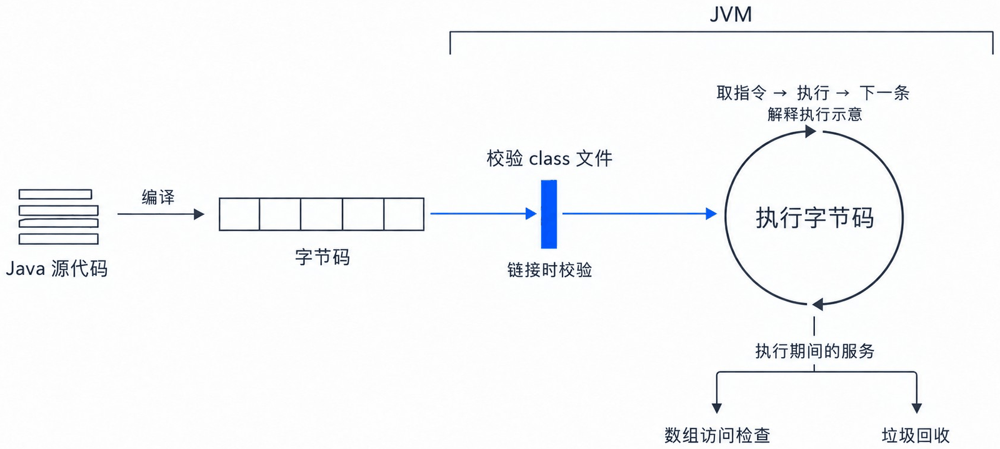
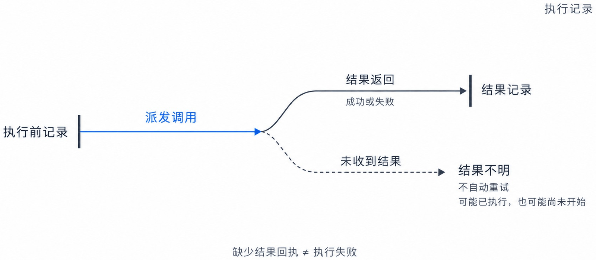
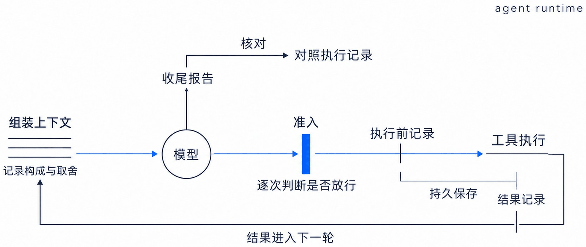
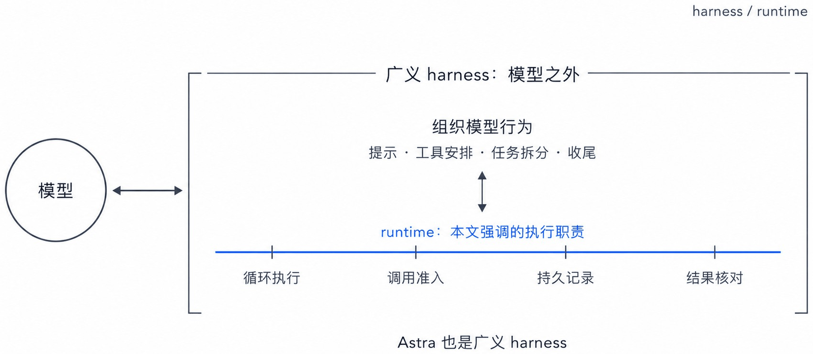
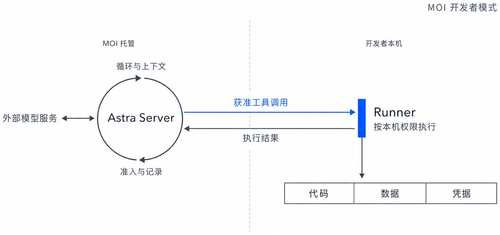
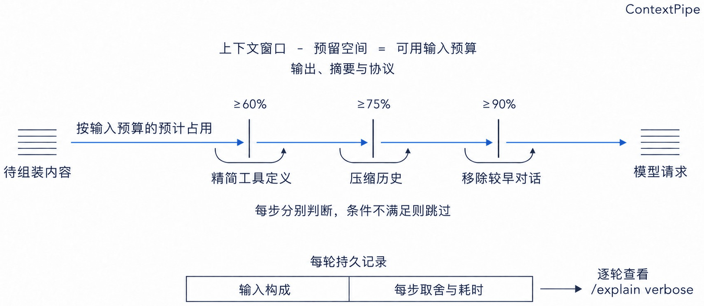

矩阵起源的 AI 数据平台 MatrixOne Intelligence（MOI）开发者模式上线。借助开发者模式，开发者可以在本地终端中，让 agent 在 MOI 上完成查询数据、导入导出文件、运行已有的工作流、创建并补充知识库等多种任务。

这些任务由矩阵起源开源的 agent runtime Astra 驱动，agent 通过 MOI 的命令行工具 moi-cli 访问平台。任务中积累的事实、偏好与决策，还可以保留到后续会话中继续使用，这部分长期记忆由 Astra 背后的记忆系统 Memoria 提供。

开发者模式使用的 Astra 及其背后的 Memoria，都已内嵌于 MOI 企业级平台。开发者在本地安装客户端和配套工具，用 MOI 账号登录即可使用，无需自行部署服务、准备模型 API key 或另建个人访问令牌。

在 macOS 或 Linux 终端中运行以下命令，即可安装 Astra 客户端及配套执行程序、moi-cli 和 skill：

```bash
$ curl -fsSL https://get.matrixorigin.cn/astra | sh
```

安装后，运行 `astra login` 登录 MOI 账号，再运行 `astra`，即可开始对话。

agent 的每一步操作由模型决定，却以开发者的身份和权限执行。任务出现问题时，开发者需要查明它实际执行了什么、在哪一步出错。执行过慢或 token 消耗过多时，需要检查各环节的耗时与每轮输入的构成。agent 声称问题已经解决时，也要核对它给出的结论与执行结果是否相符。这些判断需要运行过程留下依据。

Astra 将准入、记录和核对放在驱动 agent 运行的这一层：模型生成的每个工具调用（tool call），执行之前先由 Astra 判断是否放行，执行前后各在数据库中记录一次；每轮模型请求经过统一的上下文组装管线，记录输入的构成与取舍；agent 声称先前的失败已经解决时，对照执行记录检查它给出的证据。这一层既运行 agent，也为开发者检查它的运行过程提供依据，我们因此把它定义为 agent runtime。下面介绍这一层的职责与实现，说明开发者模式如何支持我们像 debug 软件一样调试智能体。

## runtime 的含义

runtime 是编程语言中的概念。在 Java、.NET 这样的平台上，它指运行程序并在运行期间为程序提供服务的一层软件。Java 的 runtime 是 Java 虚拟机（JVM）：Java 程序编译成字节码（bytecode），保存在 class 文件中，由 JVM 执行。

《Java 虚拟机规范》用一个循环描述 JVM 如何执行字节码：取出下一条指令，执行，再取出下一条。

除了执行，JVM 还为程序提供服务。执行之前，JVM 先校验 class 文件是否满足规范中的约束。Java 编译器生成的 class 文件都应满足这些约束，但规范指出，JVM 无法保证它加载的文件出自这样的编译器。这些文件可能来自网络，也可能是攻击者为利用虚拟机漏洞而构造的。执行期间，读取数组元素的 iaload 指令遇到越界的下标，会抛出 ArrayIndexOutOfBoundsException，开发者不必自行检查。程序无法再访问的对象，由垃圾回收器（garbage collector）回收。

JVM 能提供这些服务，是因为程序的每一条指令都由它执行：要么在这个循环中解释执行，要么先由它编译成机器码。执行程序并提供这些服务的这一层，称为 runtime。



图 1｜JVM 的执行与运行服务（解释执行示意）。

## agent runtime 如何提供调试依据

agent 的运行也是一个循环。Anthropic 在介绍托管 agent 服务 Managed Agents 的文章中，把 harness 描述为这样一个循环：调用模型，并把模型生成的工具调用交给相应的基础设施执行。harness 相当于 JVM 中负责执行的部分，模型生成的每一个工具调用都经过它。JVM 在执行之外还提供服务；agent 在 harness 之外还需要什么，取决于 agent 与 Java 程序的不同之处。

JVM 校验 class 文件，是因为无法保证它出自符合规范的编译器。模型生成的工具调用同样需要检查：模型会误读错误信息，会给出错误的参数，也可能遭到提示注入（prompt injection）。JVM 校验的是已经写成的代码，类在链接（linking）阶段被整体校验一次；agent 的下一个工具调用，却要等模型读到上一步的结果才能生成，生成后立即执行。检查因此只能放在生成与执行之间，对每个调用逐个判断是否放行。这一环节称为准入（admission）。

Java 程序要保存哪些数据，由开发者事先安排。agent 的工具调用是模型在运行中生成的，没有人能事先为它们安排记录。它们修改文件、提交代码、调用外部接口，后果留在进程之外；同一项任务再运行一次，模型生成的调用也可能不同。agent 执行过哪些操作，只能由每个调用都要经过的这层软件记录：执行之前写入一次，结果返回之后再写入一次，并持久保存。只有前一次记录而没有后一次记录的调用，结果不明。一条部署命令发出之后，网络在结果返回之前中断，部署可能已经完成，也可能尚未开始；自动重试一次，就可能重复部署。结果不明的调用因此不自动重试，下一步由用户或模型决定。



图 2｜执行前后分别记录；未收到结果不等于执行失败。

垃圾回收器依据对象是否仍可访问，判断哪些内存可以回收。agent 的上下文（context）没有这样的判据：模型每一步都读取全部输入，任何一段都可能影响下一步。输入接近上下文窗口（context window）的上限时，删去什么、保留什么、把什么改写成摘要，没有一种取舍能证明是安全的。内容的先后顺序还关系到成本：提示缓存（prompt caching）只对与之前请求逐字节相同的前缀生效，前缀中改动一个字节，之后的缓存全部失效。这些决定无法事先证明对错，只能事后查验，因此每一次纳入了什么、删去了什么，都要留有记录。

Java 程序不评判自己的结果，这由测试负责。agent 在结束时会报告“测试已经通过”，这句话同样由模型生成。agent 可能记错了哪一次运行成功，也可能在最后一次修改之后没有再运行测试。这层软件掌握每个调用的记录，agent 的报告与记录不符时，以记录为准。

驱动循环并承担这些职责的这一层，称为 agent runtime。它在 agent 运行期间常驻：每一次模型调用由它发起，模型生成的每一个工具调用都经过它。开发者排查问题时，便有依据检查某次调用的执行状态，或查验那一轮上下文的取舍。agent 报告的结果与执行记录不符时，它以记录为准。



图 3｜agent runtime 的循环、准入、记录与核对。

JVM 保证校验过的字节码不破坏内存安全，程序的逻辑是否正确，由开发者负责。agent runtime 同样只保证经它处理的部分；任务完成的质量，还取决于模型，以及提示和工具的安排。

## runtime 与 harness 的区别

harness 一词，狭义指上文所说的循环，广义指模型之外的一切：LangChain 把 agent 写成模型加 harness，Claude Code 的文档也写道，Claude Code 是 harness，Claude 是其中的模型。就广义而言，Astra 也是一个 harness。

广义的 harness 包含使 agent 更好地完成任务的各种做法：提示如何编写，提供哪些工具，任务如何拆分，何时收尾。这些做法针对的是模型的行为。Anthropic 的文章举过一个例子：Claude Sonnet 4.5 察觉上下文窗口即将用尽时，会提前结束任务，Anthropic 便在 harness 中加入了上下文重置（context reset）；换用 Claude Opus 4.5 之后，这种行为消失了，重置成了多余的负担。

准入和记录针对的是执行。无论模型表现如何，工具调用都要先经过准入，执行前后都要留下记录，输入的构成都可以查看。Java 中也有这样的分工：Spring 这样的框架决定程序如何组织，JVM 则负责执行并提供运行期间的服务。Astra 强调的，是贯穿 agent 执行的这些职责；开发者调整模型、提示或工具时，仍有运行记录可以查验。

把 harness 与它之下的 runtime 分开，业内已有先例。LangChain 的 runtime 负责持久执行（durable execution）、状态持久化和人工介入（human-in-the-loop）。谷歌的预览版 Agent Executor，可以承载不同的 harness；亚马逊的 AgentCore harness，运行在 AgentCore Runtime 提供的微型虚拟机（microVM）中。

在这样的分工中，上下文组装由 harness 负责。Managed Agents 把一份只追加（append-only）的会话日志放在 harness 之外，harness 崩溃以后，新启动的 harness 读回日志，继续运行；上下文如何管理，则留给 harness，理由是无法预知未来的模型需要怎样的上下文工程（context engineering）。Astra 的做法是：每一次组装都经过同一条管线（pipeline），纳入了什么、删去了什么，由 runtime 记录。



图 4｜广义 harness 中的行为组织与 runtime 执行职责。

## Astra 如何支撑调试

Astra 将运行控制与工具执行分开，分别由 Server 和 Runner 承担。Server 调用模型、运行循环、组装上下文，负责准入和记录，调用模型所用的密钥只保存在 Server 上。Runner 执行已通过准入的工具调用，运行在代码、数据和凭据所在的位置。在 MOI 开发者模式中，Server 由 MOI 托管，Runner 和 moi-cli 运行在开发者的本地计算机上；agent 通过本地的 moi-cli 访问 MOI。准入和记录集中在 Server 上，执行的机器重启或断网，已经写下的记录不受影响。



图 5｜MOI 开发者模式下 Server 与 Runner 的部署关系。

团队也可以自行部署 Server；Runner 还可以部署在内网，以 astra-edge 执行工具。另有一部分工具由 Server 自身执行。Astra 本身不包含模型，可以接入 OpenAI、Anthropic、DeepSeek，以及兼容 OpenAI 接口的模型服务。

模型每生成一个工具调用，Server 先确认这个工具在本轮是否可用、会话绑定在哪台机器上、参数是否合规。Server 发起审批时，待批事项先写入数据库，再等待批准，用户可以在另一台设备上批准。在开发者本地计算机上执行的调用，还要按固定顺序经过一轮权限判定：先检查禁止清单、危险命令、版本库的破坏性操作和对敏感文件的访问，最后才依据用户选择的权限模式判定。

每个工具调用，Server 都在派发之前记录一次，结果返回之后再记录一次。由 Server 自身或 astra-edge 执行的调用，另有一份执行账本（ledger）登记状态：准备（Prepared）、已派发（Dispatched）、成功（Succeeded）、失败（Failed）、被拒（Rejected）、结果不明（OutcomeUnknown）。结果先写入账本，再交给模型；调用编号用作幂等键（idempotency key），同一个编号只派发一次。派发之后没有得到确认的调用，标记为结果不明，不自动重试。Server 重启以后，执行到一半的任务也不自动重试。配置了数据库的 Server，把这些记录保存在矩阵起源的数据库 MatrixOne 中。排查中断时，开发者可以据此区分已确认的失败和仍不明的结果，再决定如何处理。

执行记录说明工具做过什么，排查模型的输入还需要查看上下文如何组装。上下文的组装借用了数据库的方法，设计出自我们的论文 ContextPipe（VLDB 2026 ADS 研讨会）。数据库的查询优化器在硬性的资源限制之下生成执行计划，并能用 EXPLAIN ANALYZE 同时列出计划和实际执行情况。论文指出，组装上下文面对的要素与查询优化器一一对应：

| 要素 | 数据库的查询优化器 | 上下文的组装 |
| --- | --- | --- |
| 意图 | 一条查询 | 用户的消息 |
| 目录（catalog） | 表、索引、统计信息 | 会话中各类内容的来源、生命周期和成本 |
| 硬性的资源限制 | 内存和 I/O | 模型的上下文窗口 |
| 分级缓存 | 缓冲池（buffer pool） | 提示缓存 |

Astra 据此把组装实现为一条管线，主任务、子任务、技能（skill）、历史压缩和子 agent，调用模型时都经过这条管线。

管线从上下文窗口中扣除为输出、摘要和协议预留的部分，余下的作为可用的输入预算。它按预算的预计占用分档处理：占用达到 60% 时，精简工具定义；达到 75% 时，压缩历史；达到 90% 时，删去较早的几轮对话。一段内容对模型有多大价值，无法像查询代价那样精确估算，所以这里的优化是启发式（heuristic）的：每一步变换都有启用的条件，条件不满足时跳过。

每一次模型请求由哪些部分组成、各占多少，写入数据库；每一轮的记录还写明历史保留了几轮、压缩了几轮、删去了几轮。在对话中输入 `/explain verbose`，可以逐轮查看上下文的构成和各环节的耗时，如同在数据库中用 EXPLAIN ANALYZE 查看一条查询的计划和实际耗时。

以一次查询 MOI 工作区的对话为例，第四轮的记录写明：输入共 13,705 token（模型服务返回的用量），其中 8,192 读自缓存；按 Astra 的估算，系统提示（system prompt）约 4,860，17 个工具的定义约 1,816，此前三轮对话约 221。这一轮的占用远未达到 60%，历史全部保留，没有压缩。在发生压缩的一轮，记录还写明经过了哪几步压缩、每一步腾出多少 token，以及压缩前后历史各有多少。待组装的内容、统计信息和配置都相同时，组装出的请求逐字节相同。缓存失效时，Astra 会判断原因：系统提示有变化，某个工具的定义有变化，更换了模型或模型服务商，或者缓存已经过期。



图 6｜ContextPipe 按预算组装请求，并记录每一步取舍。

agent 声称先前的失败已经解决时，需要指明哪些调用属于那次失败，哪些调用是证据。Astra 对照执行记录逐项检查：被指为失败的调用，确实执行过并且失败；被引为证据的调用，确实执行过，并且发生在最后一次失败之后；证据中至少有一次成功的结果；agent 没有同时列出遗留的问题。任何一项不满足，Astra 都不接受这一结论，任务仍记为尚未验证。开发者据此判断这次修复是否有后续执行结果支持。

## 安装与使用

通过 MOI 开发者模式使用 Astra，需要在 macOS 或 Linux 的终端中依次运行以下三条命令：安装 Astra 和 moi-cli，在浏览器中登录 MOI 账号，然后开始对话。

```bash
$ curl -fsSL https://get.matrixorigin.cn/astra | sh
$ astra login
$ astra
```

完整步骤见 MOI 文档《在终端安装 Astra 并查询 MOI 工作区》。

## 结语

agent 的工具调用由模型在运行中生成，生成后立即执行，后果留在进程之外。Astra 把准入、记录和核对放在驱动这一过程的 runtime 中：每个调用执行之前先判断是否放行，执行前后留下记录，上下文的取舍和 agent 事后的报告也有依据可供查验。

通过 MOI 开发者模式，moi-cli 让 agent 访问 MOI，Astra 则让开发者能够检查它怎样完成任务。哪里出错、每轮输入如何组成、时间和 token 消耗在哪里，以及“已经解决”是否有执行结果支持，都有运行记录可供核对。这是开发者模式支持我们像 debug 软件一样调试智能体的基础。
