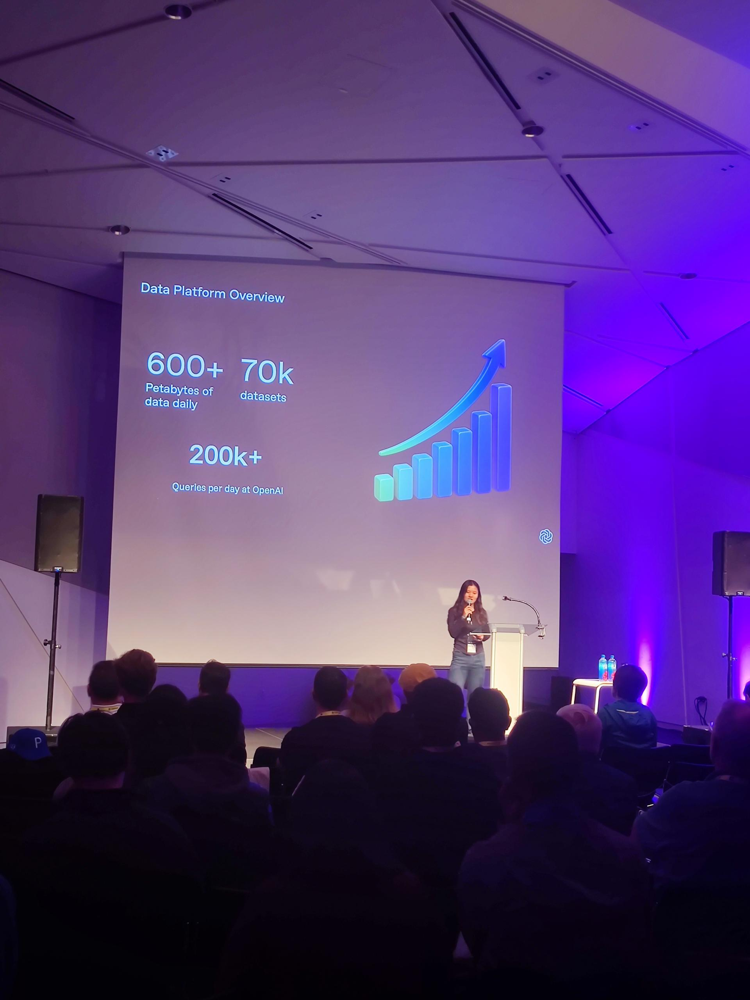
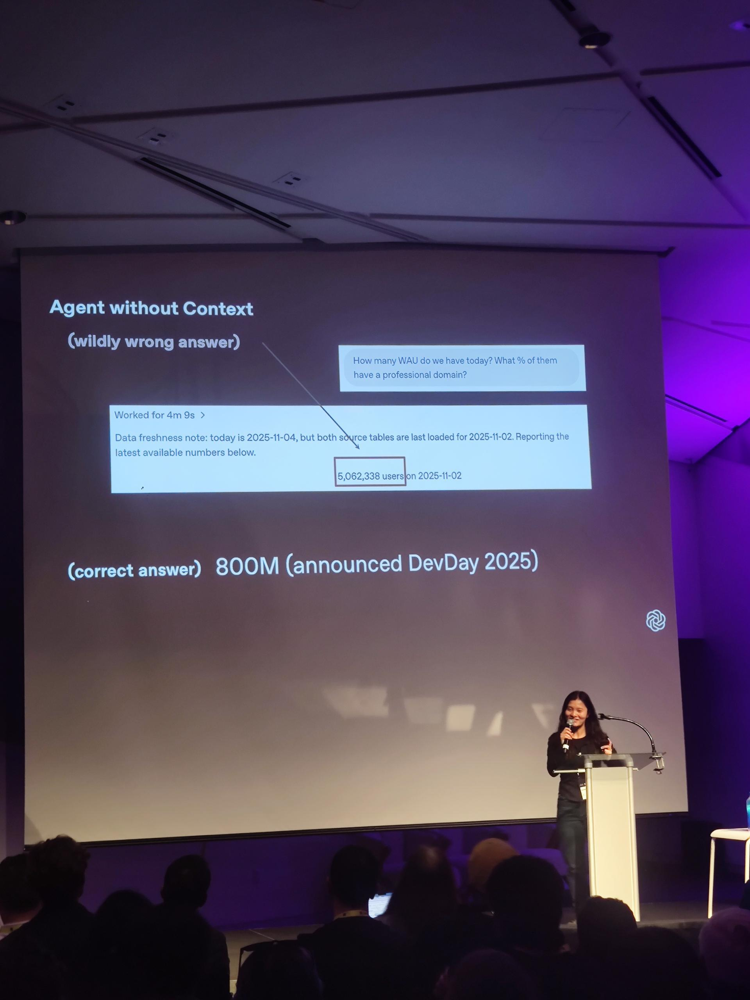
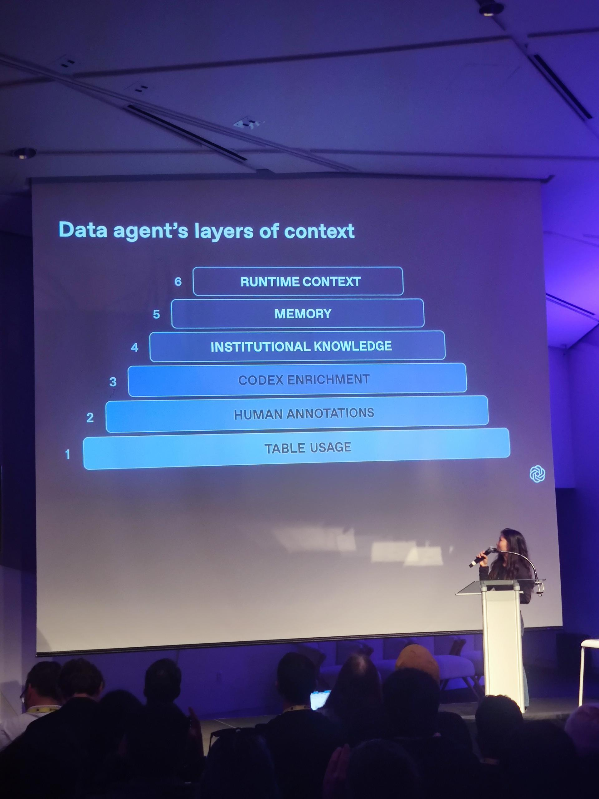
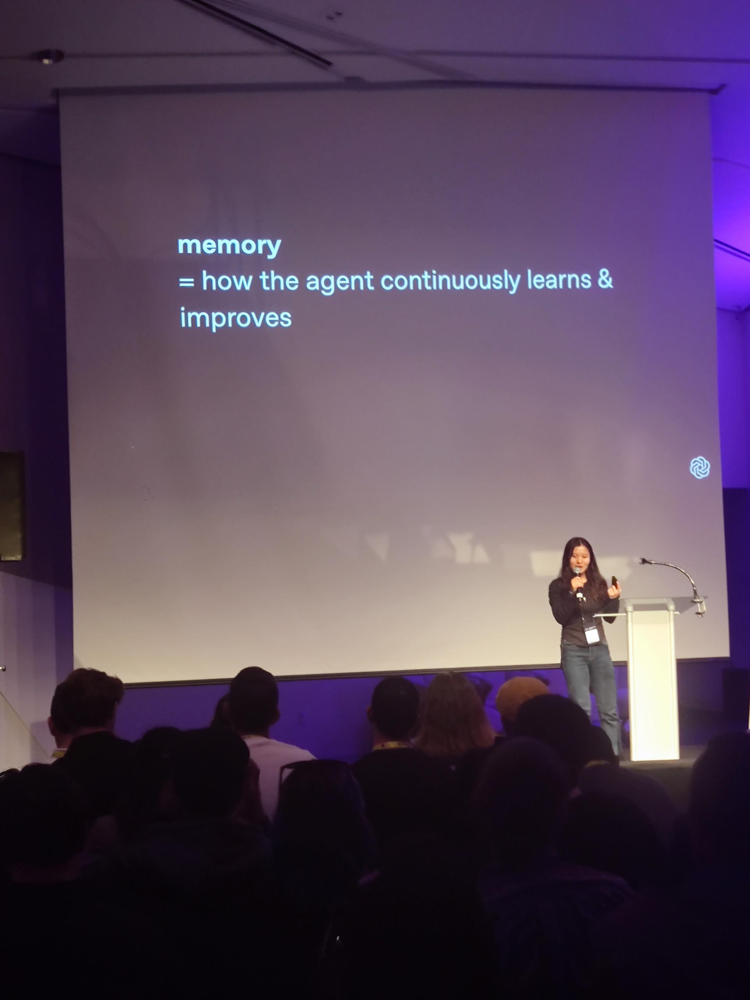
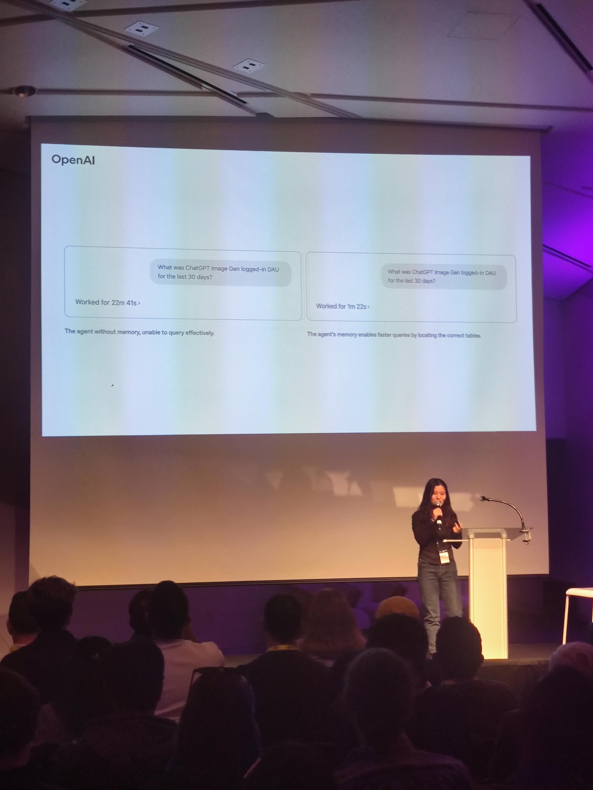
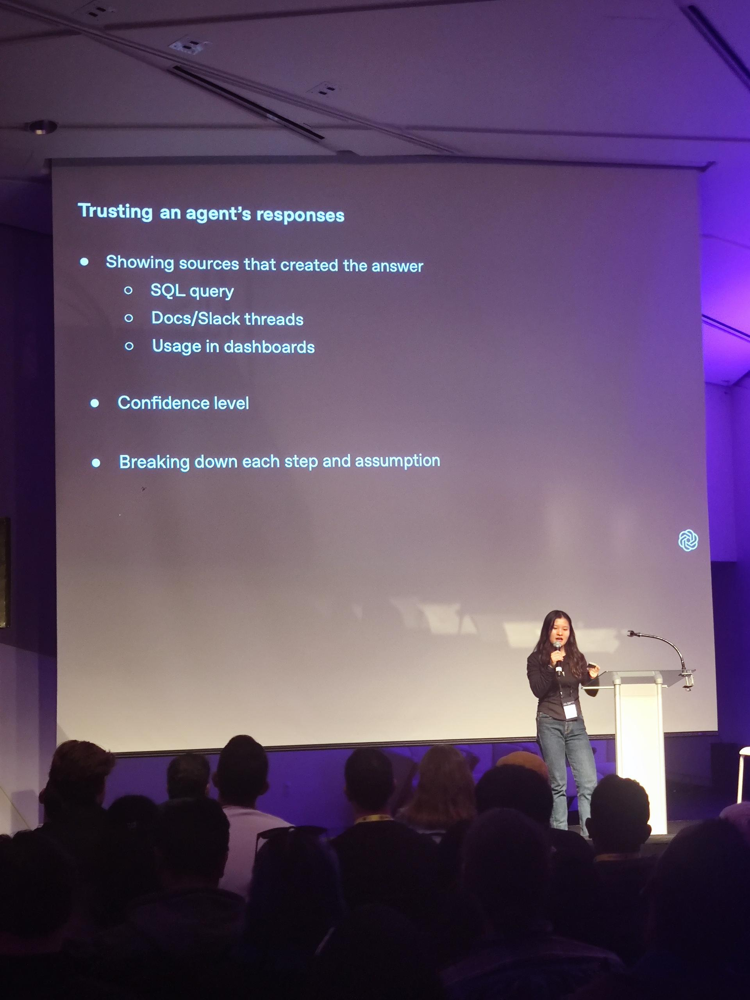
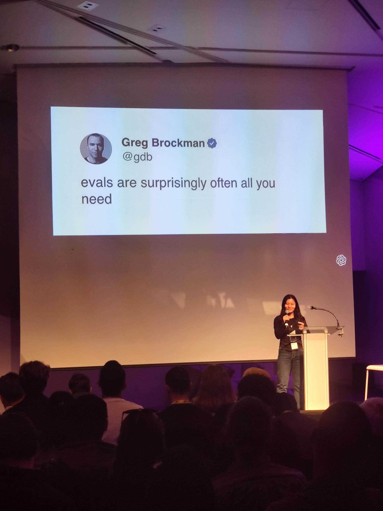
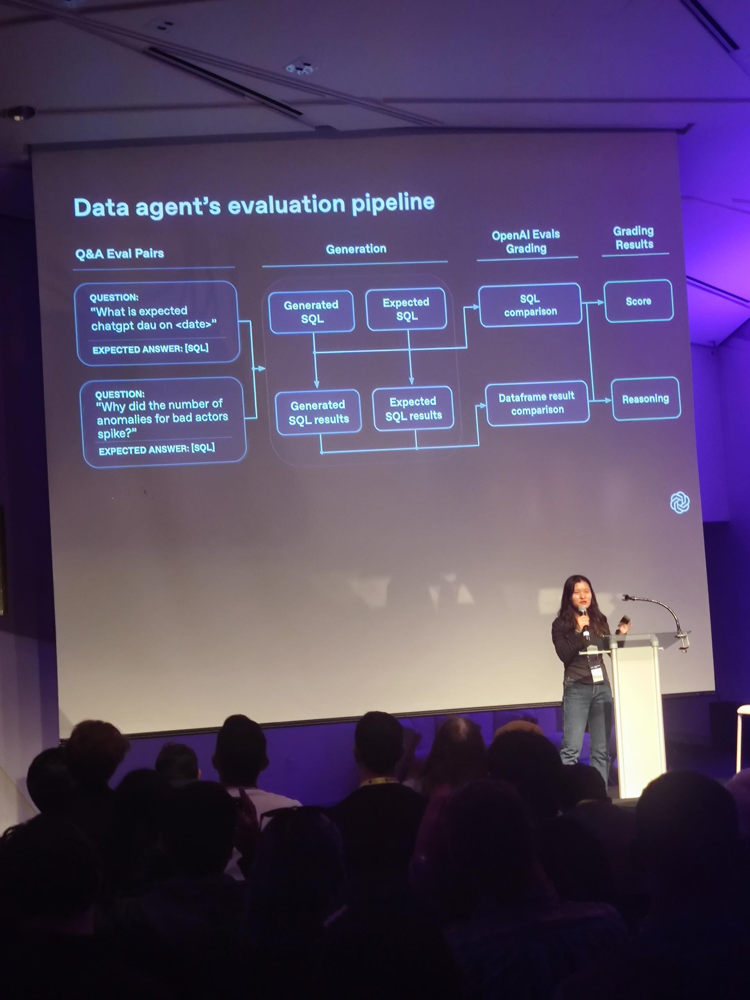
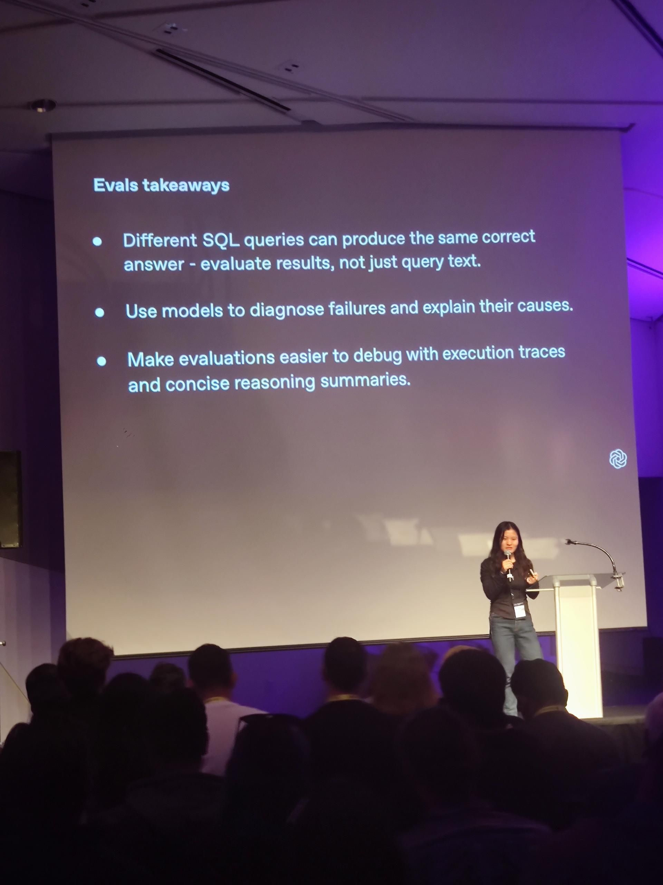
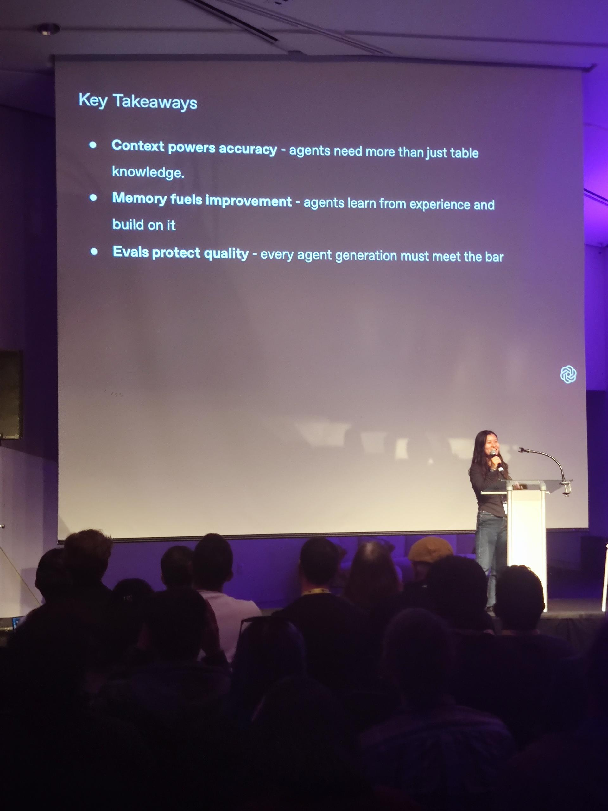

*Part one of this series: 60 Years of HTAP: Breakups and Reunions — Why the Agent Era Calls for a Clean-Slate Redesign*

*Part two: DuckDB's Ambition and the New Database Question of the Agent Era*

This final installment turns to a real-world case from inside one of the world's leading AI companies.

At the Rows & Columns Summit, Bonnie Xu, an engineer on OpenAI's data platform team, walked the audience through the Data Agent built inside OpenAI. First, consider the scale of the data it has to work with:

*Figure 1 | The scale of OpenAI's Data Agent: 600+ PB of new data per day, 70,000 datasets, and 200,000+ queries a day.*

By mid-2026, the platform was taking in more than 600 PB of new data every day, spanning 70,000 datasets and more than 200,000 queries daily. At that scale, managing data and writing SQL by hand is simply not viable. Data Agents address a genuine need — but governing their process and validating their output present real challenges of their own.

## A Wildly Wrong Answer, and the Agent's Blind Spot

Bonnie showed a real failure of the Data Agent. Ask it how many weekly active users ChatGPT had, and what share came from professional domains, and it would work diligently for four minutes before returning a polished answer: 5,062,338 users.

The correct number was **800 million** — the figure OpenAI published at DevDay 2025.

*Figure 2 | An agent without context ran for four minutes and missed the answer by two orders of magnitude.*

Where did it go wrong? The model was not the problem. The agent lacked context — it did not know which tables were current, how those tables related to one another, or how fresh the data was.

An agent without context can return results that are spectacularly wrong.

## OpenAI's Answer: A Six-Layer Context Framework

OpenAI offered a design worth sitting with: **a six-layer context framework for Data Agents.**

Those six layers run from the runtime context and memory closest to the user, through institutional knowledge, Codex enrichment, and human annotations on schemas, down to table usage information at the base.

*Figure 3 | The six-layer context framework for Data Agents.*

The elegance of the design lies here: an agent's capability does not come from a stronger model. It comes from being enriched, layer by layer, with context.

## One Architecture, Independently Reached: MOI Has All Six Layers

That layered design maps closely onto the architecture MatrixOrigin has built — MatrixOne Intelligence (MOI) and its purpose-built unified platform for trusted agents:

- **Astra Agent Harness**, with its context-building layer — runtime context and model enrichment;
- **Memoria**, the memory component — the memory layer;
- **A RAG-based enterprise knowledge graph service** — institutional knowledge;
- **The MatrixOne data foundation** — the data and schemas at the base.

What OpenAI validated through internal engineering practice, MOI has already delivered as an enterprise product.

## Memory: The Foundation of an Agent That Keeps Improving

Bonnie was emphatic: **memory is what allows an agent to keep improving.** It determines how an agent learns and refines its behavior over time.

*Figure 4 | Memory is how the agent continuously learns and improves.*

A telling comparison makes the point. For the same query — login DAU for ChatGPT Image Gen over the last 30 days — an agent without memory took **22 minutes and 41 seconds**. With memory, it located the right table in 1 minute 23 seconds: 16 times faster.

*Figure 5 | With memory versus without memory: 22m41s to 1m23s.*

This aligns closely with the thinking behind Memoria. It stores each agent's daily memory as data on the MatrixOne foundation, so that **memory management is trackable, traceable and testable.**

Memory is not text drifting through a conversation. It is data that can be governed.

## Trust: Show the Sources, Show the Steps

Before enterprises can put an agent into a core business process, they have to be able to trust it. OpenAI's approach is to show where an answer came from — the SQL query, documents and chat logs, and dashboard usage — give a confidence level, and break down each reasoning step and assumption.

*Figure 6 | Making a Data Agent's answers trustworthy: sources, confidence, and a step-by-step breakdown.*

MOI agents likewise surface their data sources when interacting with users, and developer mode reveals step-by-step execution. More than that, **MOI stores every agent's execution trace in the MatrixOne foundation.** When something goes wrong, teams can replay the full run and investigate, instead of debugging a black box.

## Evals: The Lifeline of Quality

Bonnie quoted OpenAI president Greg Brockman: **"Evals are surprisingly often all you need."**

*Figure 7 | Greg Brockman: "Evals are surprisingly often all you need."*

OpenAI's evaluation pipeline starts with question-answer pairs, compares the generated SQL with the expected SQL and their execution results, then has Evals score the output and explain its reasoning.

*Figure 8 | OpenAI's evaluation pipeline for the Data Agent.*

Three takeaways on evaluation are worth keeping in mind for any team building a data agent:

*Figure 9 | Evals takeaways: evaluate results rather than SQL text, diagnose failures with models, and cut debugging cost with execution traces.*

- **Different SQL can produce the same correct answer — evaluate the result, not the SQL query itself.**
- **Use models to diagnose failures and explain why they happened.**
- **Evaluation and debugging should be grounded in execution traces and concise reasoning summaries.**

MOI likewise supports natural-language-to-SQL interaction and retains complete agent execution traces — **trackable and traceable** — so evaluation and troubleshooting have a solid basis.

## The Final Act

*Figure 10 | Key takeaways: context determines accuracy, memory drives improvement, evals hold the quality line.*

Bonnie's three core takeaways are these: **context determines accuracy, memory drives continuous improvement, and evals protect the quality bar.**

Those three ideas are precisely the design axes of the MOI platform:

- **Reliability** — agents that can be trusted to plug into core business processes;
- **Coordination** — hundreds of agents working together to lower cost and raise output;
- **Self-evolution** — agents that keep improving, with intelligence emerging over time.

MOI is already deployed at scale in manufacturing, energy, healthcare, internet and semiconductors, serving more than 100 enterprise customers.

Looked at as a whole, the series tells a single story in three acts:

- **Act one** (Andy Pavlo): 60 years of HTAP databases splitting and reuniting, and why the agent era calls for a clean-slate redesign;
- **Act two** (DuckDB): DuckDB's ambition and the new database question of the agent era;
- **Act three** (OpenAI): the internal Data Agent and MatrixOrigin's enterprise-grade AI platform answer — all of which requires a reliable enterprise AI platform.

**Three acts, one thread: every agent in the AI era deserves a platform that understands it. That is what MatrixOrigin is building.**
