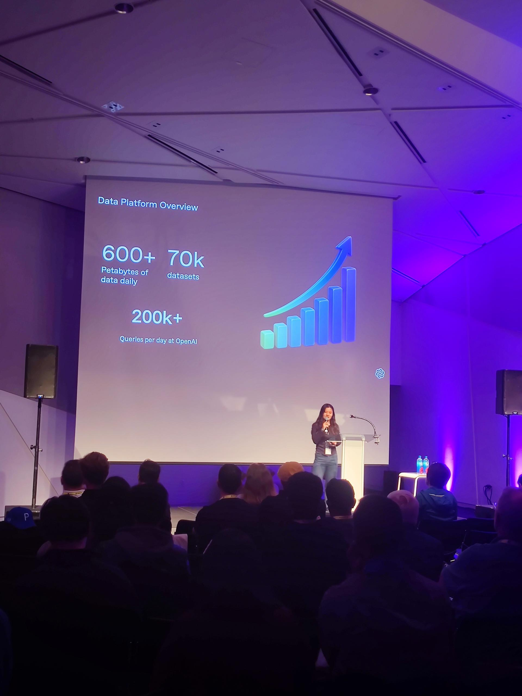
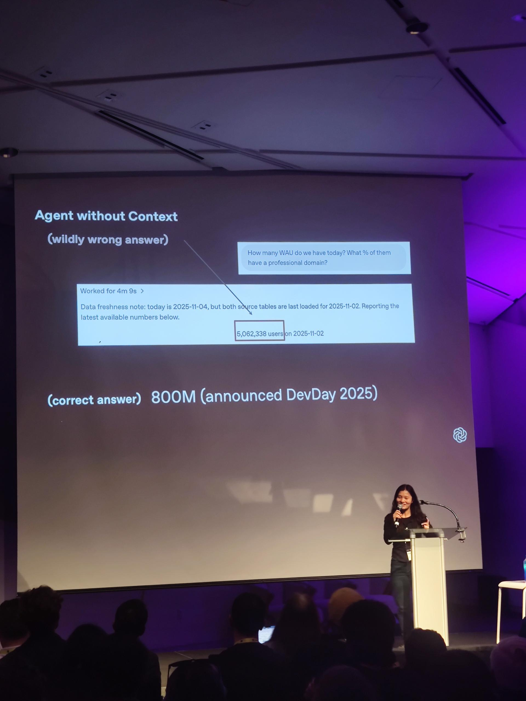
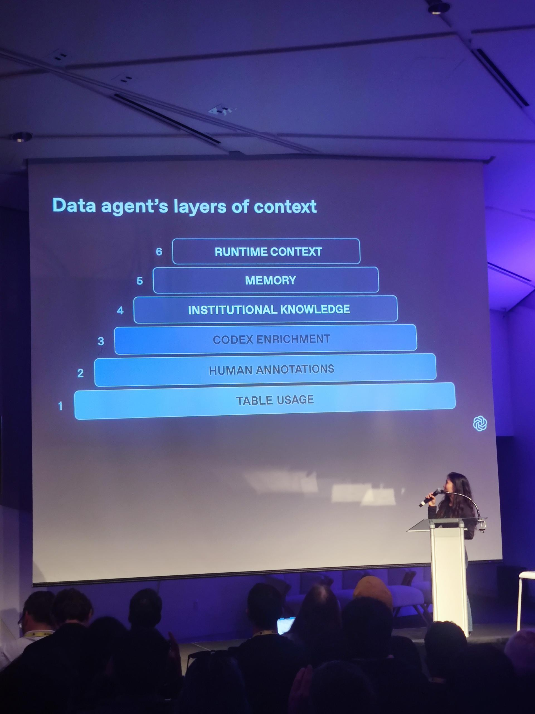
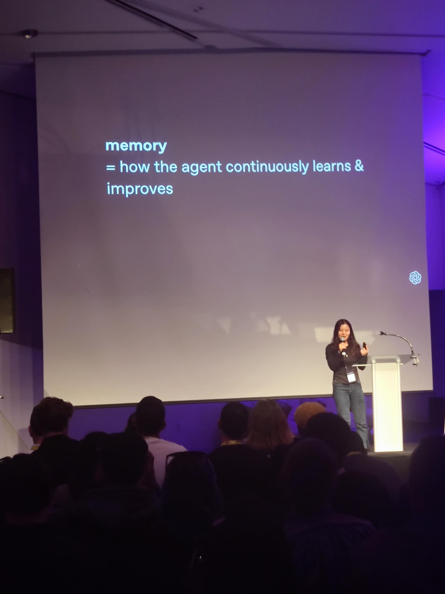
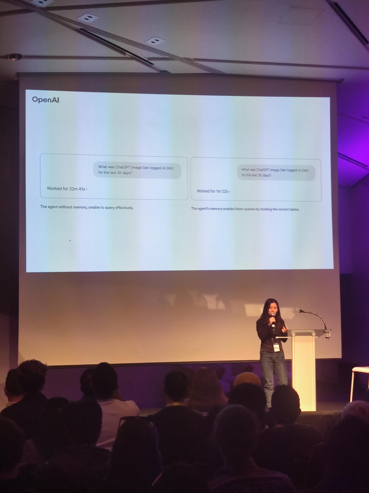
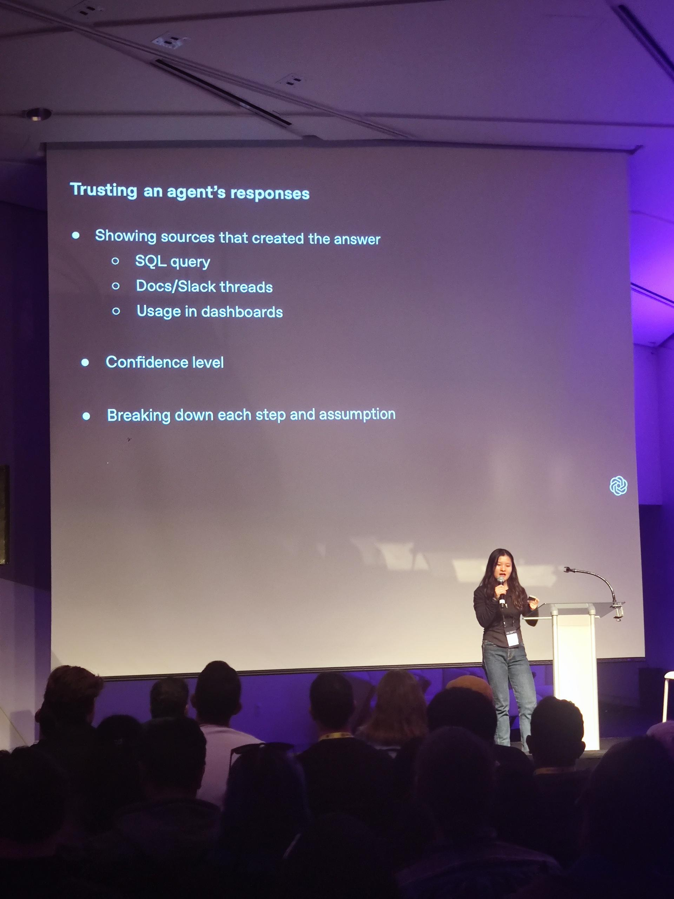
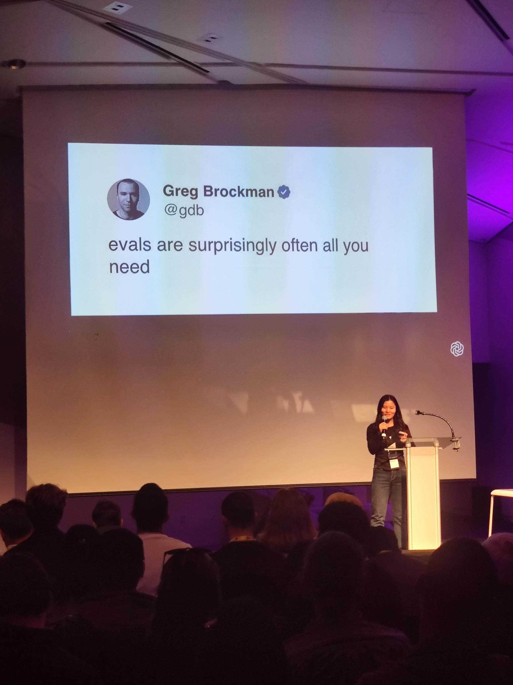
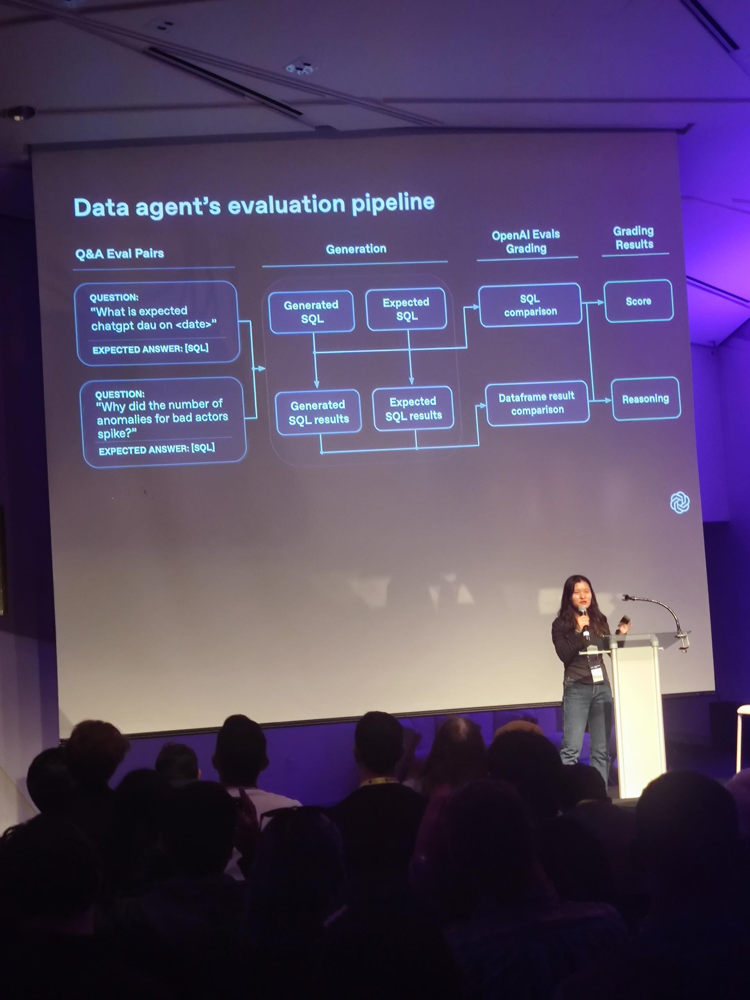
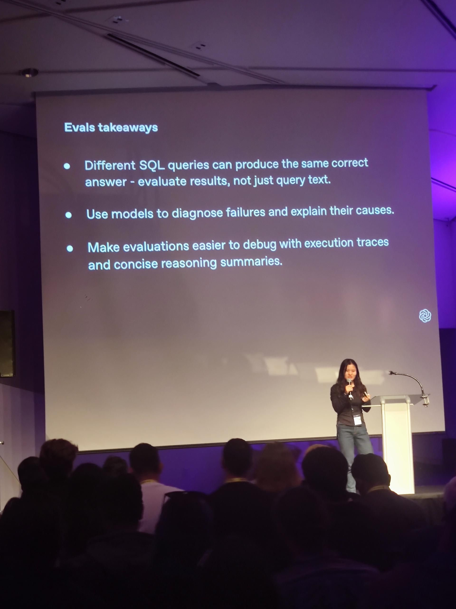
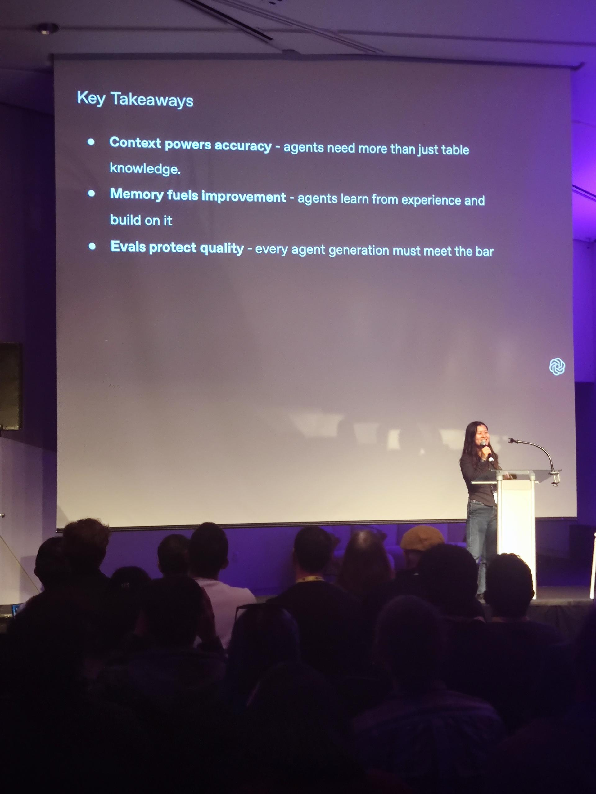

*系列第一篇：《60 年 HTAP 数据库的分分合合，为什么说 Agent 时代需要一次「推倒重来」？》*

*系列第二篇：《DuckDB 之野望与 Agent 时代数据库的新命题》*

本次为系列收官篇，讲一个「AI 大厂 Agent 真实案例」。

在 Rows & Columns Summit 会场上，OpenAI 数据平台工程师 Bonnie Xu 拆解了 OpenAI 内部的 Data Agent。先感受一下需要面对的数据规模：

*图 1｜OpenAI Data Agent 数据规模：每天 600+ PB 新增数据、7 万个数据集、每天 20 万+ 次查询。*

截止2026年中，每天新增数据超过 600 PB 、7万个数据集、每天查询超 20万次。**数据规模到这个量级，靠人肉去管理数据和写 SQL 已经不现实**

——Data Agent 有真实的应用需求，但过程管理和数据验证，也面临实际的挑战。

## 一、一个「离谱」的错误回复，暴露了 Agent 的命门

Bonnie 展示了 Data Agent 曾发生过的一个错误：问 Agent「ChatGPT 有多少个WAU？其中来自专业域名占比多少？」——Agent 辛辛苦苦跑了 4 分钟，给出了一个看起来有模有样的答案：5,062,338 个用户。

而正确答案是：**8 亿**（DevDay 2025 官方公布的数字）。

*图 2｜Agent without Context：跑了 4 分钟，结果却差了两个数量级。*

错在哪？不是模型不够聪明，而是 Agent 缺少 Context**——它不知道哪些表是最新的、多个表之间的关系、以及数据新鲜度如何。**

缺少 Context 的 Agent，返回的结果可能错得离谱。

## 二、OpenAI 的解法：6 层 Context 范式

OpenAI 给出了一个非常值得反复咀嚼的设计 —— **Data Agent 的 6 层 Context 范式**

这6层包括，从最贴近用户的运行时 Context（Runtime Context）和记忆体（Memory），到企业内部知识库（Institutional Knowledge）、模型能力增强（Codex Enrichment）、数据 Schema 的人工标注（Human Annotations），再到最底层的表使用信息（Table Usage）。

*图 3｜Data Agent 的六层 Context 范式。*

这个多层次设计范式最精妙之处在于：**Agent 的能力不是靠一个更强大的模型提升的，而是靠一层一层 Context 「增强」的。**

## 三、英雄所见略同：MOI 把这 6 层都备齐了

上述多层次设计范式，与矩阵起源提出的架构不谋而合，包括 MatrixOne Intelligence（MOI），以及自主研发的可信 Agent 统一平台：

**Astra Agent Harness**（含 Context 构建层）——对应运行时 Context 与模型能力增强；

**Memoria 记忆组件**——对应 Memory 层；

**基于 RAG 的企业知识图谱服务层**——对应企业内部知识库；

**MatrixOne 数据底座**——承载最底层的数据与 Schema。

OpenAI 用内部工程实践验证的架构，MOI 已经把它做成了面向企业的产品。

## 四、Memory：Agent 持续进化的根本

Bonnie 强调：**记忆体是 Agent 持续提升的根本，**决定了 Agent 如何持续学习并不断改进。

*图 4｜memory = how the agent continuously learns & improves*

一个直观的对比：同一个查询「ChatGPT Image Gen 近 30 天登录 DAU」，没有记忆的 Agent 跑了**22 分 41 秒**；有记忆的 Agent 定位到正确的表，只用了 1 分 23 秒——快了 16 倍。

*图 5｜有记忆 vs 无记忆：22m41s → 1m23s。*

这与矩阵起源 Memoria 的设计理念不谋而合：Memoria 把 Agent 每天的记忆内容以数据形式存储在 MatrixOne 数据底座上，保证**记忆管理可追踪、可溯源、可回测。**

记忆不是一段飘在对话里的文本，而是一份可以治理的数据。

## 五、可信：给出数据源，亮出每一步

企业要让 Agent 融入核心业务流程，先得做到可信。OpenAI 的做法是：展示答案的来源（SQL 查询、文档/即时通讯记录、看板使用情况），给出置信度，以及拆解每一步推理与假设。

*图 6｜数据 Agent 回复的可信实现：来源、置信度、分步拆解。*

MOI Agent 与用户交互时同样给出数据来源；开启开发者模式后，还会展示分步执行信息。而且，**MOI 会把所有 Agent 的执行轨迹保存在 MatrixOne 数据底座中；**出了问题，可以完整回放排查，而不是对着一个黑盒不断调试。

## 六、Evals：质量的生命线

Bonnie 引用了 OpenAI 总裁 Greg Brockman 一句话：**「评测往往出人意料地正是你所需的一切。」**

*图 7｜Greg Brockman：evals are surprisingly often all you need*

OpenAI 的评测管线从问答对出发，对比生成 SQL 与期望 SQL、以及执行结果，再由 Evals 打分并生成推理说明：

*图 8｜OpenAI Data Agent 的评测管线。*

三条评测心得值得每个做数据 Agent 的团队谨记：

*图 9｜Evals takeaways：评测结果而非 SQL 文本、用模型诊断失败、用执行轨迹降低调试成本。*

**不同的 SQL 可以得到同样的正确答案——评测的是结果，而不是SQL查询本身**；

**用模型来诊断失败、解释原因**；

**评测调试应基于执行轨迹和简洁的推理摘要**。

MOI 平台同样支持自然语言到 SQL 的交互方式，并保留完整的 Agent 执行轨迹——**可追踪、可溯源**，使评测与排查有据可依。

## 七、写在系列最后

*图 10｜Key Takeaways：Context 决定准确度、Memory 驱动改进、Evals 守住质量。*

Bonnie 的三个核心心得包括：**Context 决定准确度，Memory 驱动持续改进，Evals 守住质量底线。**

这三件事，恰恰就是 MOI 平台的设计主轴——

**可靠**：让 Agent 可靠地接入核心业务流程；

**协同**：让数百个 Agent 协同工作，降本增效；

**自进化**：让 Agent 持续自进化，智能涌现。

目前，MOI 已在制造、能源、医疗、互联网、半导体等行业规模化落地，累计服务企业客户超过 100 家。

回看整个系列，其实是同一条故事线的三幕：

**第一幕**（Andy Pavlo）：60 年 HTAP 数据库的分分合合，为什么说 Agent 时代需要一次「推倒重来」；

**第二幕**（DuckDB）：DuckDB之野望与 Agent 时代数据库的新命题；

**第三幕**（OpenAI）：OpenAI 内部 Data Agent，与矩阵起源企业级智能平台解决方案——而这一切，都需要一个可靠的企业级智能平台。

**三幕落幕，主线只有一个：AI 时代的每一个 Agent，都值得一个懂它的智能平台。这正是矩阵起源在做的事。**
